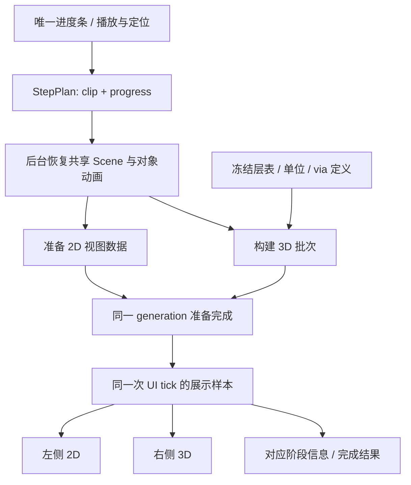

# Replay 右侧同步 3D 视图设计

日期：2026-11-16。状态：方案草案，尚未实现。本文基于当前 Native、Replay 和真实 `gcd/ws_0004` 数据分析，不把设计目标当作已测能力。

## 1. 建议与范围

采用**同一个 Native 窗口、同一个 Replay 播放器、同一份场景、左右两种投影**。左侧继续显示 2D 版图，右侧增加 3D 版图；进度条、播放/暂停、倍速、step/subflow 节点仍只有一套。

同步必须落实到动画中间态，而不仅是同时切换 step。例如 Place 移动到 40% 时，两侧同一 instance 的 XY 位置一致；Filler 的 1.5 秒铺展，两侧出现相同批次；Route 波次推进时，两侧显示相同 revision 的线、via 和活动区域。3D 相机可以独立旋转，不拥有独立的流程播放时钟。

第一版复用现有 geometry diff 和冻结元数据，无须为 3D 再跑工具、另存整套逐帧 3D 文件。几何仍是当前 Replay 已采集的 physical bounds；单元用包围盒体块表示，金属按 layer 分层拉伸。现有 3D 的高度也是启发式示意，不能标成实际工艺厚度或晶体管级三维结构。

本设计默认用户通过工具栏的“同步 3D”打开视图，初次保持现有 2D 布局。开启后保持至关闭窗口，跨 step 不重置。关闭时取消 3D 专用准备、释放其缓存，不增加 EDA 抓取或算法开销。此次设计不改变 workspace 的 Replay 开关和动态 flow 配置。

## 2. 已确认的代码基础

| 现有位置 | 已有能力 | 接入时的限制 |
| --- | --- | --- |
| `chip-viewer/apps/chip-viewer-native/src/replay.rs` | 一个 `ReplayApp` 管理 position、step、播放速度、场景和结果面板 | 当前 CentralPanel 只有 2D/逻辑视图 |
| `replay_plan.rs`、`replay_playback.rs` | 按可见变化规划时长；加载时暂停时钟；精确帧定位；Filler 合批 | 3D 必须服从已有 clip，不另算时长 |
| `replay_loader.rs` | 后台恢复场景、准备 Motion/Reveal/空间索引，generation 淘汰旧请求 | 需将两种投影的准备纳入同一代次交付 |
| `replay_motion.rs`、`replay_reveal.rs` | 位移起终点、smoothstep、出现顺序/时间窗、删除残影 | 应抽取共享对象动画描述，避免 3D 重写一套规则 |
| `replay_gpu_animation.rs`、`replay_gpu_mesh.wgsl` | 动画网格常驻 GPU，每次更新 progress uniform | 现有属性是 2D 屏幕坐标，不能直接给 3D 使用 |
| `canvas_gpu3d.rs` | 实例化体块、材质/高亮、离屏颜色与深度、相机 uniform、GPU callback | 当前实例只有目标 bbox/Z，没有 Replay 起点/出现时间；key 变化会整批上传 |
| `camera3d.rs`、`nav3d.rs` | OrbitCamera、旋转/缩放/平移、Fit、顶视/正视/等轴测 | 可复用；导航动画与流程动画分开 |
| `app.rs::build_3d_instances` | 普通 viewer 的 3D 场景构建、筛选、overview | 依赖 `LoadedViewer`/静态 GeometryDb，不宜整体搬入 Replay |
| `chip-display::heuristic_layer_stack` | 由 layer role/order 生成稳定的分层示意高度 | 不是实际 PDK 厚度；不得每帧按当前可见层重新生成 |
| ECC `replay_artifacts.py::freeze_geometry` | 将 final geometry manifest、layers、vias 等冻结并记录文件指纹 | 可借用层定义/单位，不能把最终 shapes 提前画到过程帧 |

已实读 `ws_0004`：Filler attempt 有 `final_geometry`、冻结的 `layers.txt`、`vias.txt`，geometry manifest 带 `dbu_per_micron=1000`。Rust Replay 的 `Manifest` 目前未显式解析 `final_geometry`，reader 的 manifest/layer 独立读取函数也是私有；实现需补小型元数据入口，不能假定现已可直接调用。不要为了拿层表就打开整个最终 shapes 数据库。

## 3. 方案比较

| 方案 | 优点 | 代价/不足 | 选择 |
| --- | --- | --- | --- |
| 同进程双视口，共享场景和动画 | 内存可共享、同一绘制帧采样、节点定位一致 | 需要 Replay→3D 适配和 GPU 动画支持 | 推荐 |
| 启动第二个普通 3D Viewer，发送进度 | 普通 viewer 界面可直接使用 | 两套 loader/场景、跨进程进度和取消同步、容易一快一慢；静态 viewer 不认识过程动画 | 不用于第一版 |
| 每次导出 3D 快照或截图 | 易于离线展示某个结果 | 无自由旋转、占空间、过程不连续、又引入抓取链路 | 不符合实时交互回放目标 |

复用的是渲染器、材质、相机和层表规则；新增的是 Replay 数据适配及动画桥接。无需先构造完整的普通 `LoadedViewer`，也不应每一帧导出临时 `.chipgeom` 再重新打开。

## 4. 界面与交互

推荐首版采用左大右小的可调双栏。右栏上方为 3D，下方为已有分析结果；这比在 1280 像素窗口中并排挤三个窄栏更实用。

```text
┌─────────────────────────────────────────────────────────────┐
│ Layout Replay   Fit 2D   同步 3D ☑   播放变化动画 ☑           │
├─────────────────────────────────┬───────────────────────────┤
│                                 │ 3D  Fit / Iso / Top       │
│                                 │                           │
│         2D 版图                 │ 同一进度的 3D 版图        │
│                                 │ 独立旋转 / 缩放 / 分层    │
│                                 ├───────────────────────────┤
│                                 │ 当前阶段 / Map 列表       │
│                                 │ 完成后的树状时钟视图      │
│                                 │ 指标及变化量              │
│                                 ├───────────────────────────┤
│                                 │ Step checklist            │
├─────────────────────────────────┴───────────────────────────┤
│ ▶  ──○────○────●────○────○────●─────  倍速 / 当前 step        │
└─────────────────────────────────────────────────────────────┘
```

- 默认左栏约 58%、右栏约 42%；右栏上部约 60% 留给 3D。横向/纵向分隔条可拖动，报告可折叠以扩大 3D。窄窗口仍保留两视图，报告可折叠；不再增加第二条进度条。
- 右下方 Map 名称列表、完成结果和 checklist 继续显示；时钟树保留独立树状视图，不嵌入 3D 版图。只有到达完成节点才显示相应分析结果。
- 鼠标在 2D 区域只控制 2D；在 3D 区域只控制 3D。时间同步始终开启；相机同步不强制绑定。
- “定位到当前 2D 区域”作为显式命令，将 3D 的 XY 关注区域移到 2D 可见范围，保留观察方向。第一版不做持续相机追随，避免旋转时被 2D 抢回视角。
- 沿用 `selected_objects` 的对象 ID，两侧选择高亮一致。第一版至少实现 2D 选择→3D 高亮；3D 点击反选通过局部射线与当前插值包围盒检测实现，不能拾取尚未出现或已删除对象。
- 初次有物理边界时 Fit 一次；默认启用下节的“阶段视角”，只在有展示意义的阶段边界平滑调整。用户手动操作后保持相机、Z 缩放及层筛选，直到显式恢复自动视角。
- 对只有逻辑/报告的阶段，右侧显示“当前阶段无物理版图”，不得展示后续阶段的最终 3D 结果。未知/缺失几何不伪造填充模型。

## 4.1 按阶段设计视角（补充用户意见）

3D 的重点是帮助解释当前操作。默认开启“阶段视角”，每个阶段采用能看清其变化的镜头；2D 始终保留稳定俯视参考。镜头设计包括**俯仰角、关注区域、层可见性建议和 Z 展示比例**，不是每个 step 随意旋转一次。下表角度为相对 XY 平面的俯仰角初始建议，需通过录屏调整，不是工艺参数。

| Step / 子阶段 | 推荐视角 | 主要展示内容与镜头行为 |
| --- | --- | --- |
| Synthesis / 其他无物理几何阶段 | 无物理 3D 空态 | 保留逻辑/报告，不展示下一步才生成的 die |
| preFloorplan：die/core/row | 接近俯视，70–80° | 看边界扩展、core 留边和行生成；边界变化时平滑调整取景范围，不连续旋转 |
| macroPlacement | 斜俯视，55–65° | 看 macro 体块位置、朝向和通道；以 macro 活动范围取景，不逐个追踪随机移动的单元 |
| postFloorplan：IO | 斜俯视，65–75° | 完整 die 周边在画面内，突出 IO 排列；不把背面 IO 藏在低角度遮挡后 |
| postFloorplan：tap/endcap | 斜俯视，65–75° | 看行内插入规律；固定镜头，新增类型高亮 |
| postFloorplan：PDN | 等轴倾斜，30–40° | 显示金属层高度和电源条带逐层出现；允许建议较大的示意 Z 比例，仍不改变数据单位 |
| preplace | 较高俯视，70–80° | 看初始单元分布与固定对象；同后续 Place 的坐标朝向 |
| place：优化移动 | 较高俯视，70–80° | 固定 yaw，优先看平面移动和轨迹；无需为每次迭代调整镜头 |
| place：Map 结果 | 顶视或近顶视，80°–相机上限 | 弱化遮挡，突出贴在 core 上的 Map；每张 Map 切换保持同一相机，便于比较 |
| diff_sizing | 斜俯视，60–70° | 看修改/新增 instance 高亮；变化集中时最多选择一个稳定区域，并保留外围上下文 |
| CTS | 斜俯视，50–60° | 看 buffer 分布、已有时钟物理连线；真实连线尚未生成时仅显示已有单元/记录，不把逻辑树变成物理线 |
| legalization | 较高俯视，75–85° | 行对齐、重叠消除和小范围位移最清楚；行方向不随镜头旋转 |
| Timing optimization | 斜俯视，60–70° | 看 resize/buffer/move 的局部变化；只有已有记录包含路径时才突出路径 |
| route：PA | 高俯视，65–75° | 接入点、候选、box 划分；当前层为主，避免多层堆叠遮住细点 |
| route：GR | 斜俯视，55–65° | 主要看 GCell、guide 与拥塞；按当前选择层显示观测平面 |
| route：TA | 等轴倾斜，40–50° | 展示 track 在不同金属层的分配关系 |
| route：DR / patch / repair | 较低等轴倾斜，30–40° | 显示 wire/via 层间关系、活动 box、局部修补；同一算法阶段内镜头固定，不随每个 wave 来回跑 |
| filler | 高俯视，70–80° | 快速看行间空隙被填充；仍为 1.5 秒铺展，不为镜头额外增加停留 |
| lvs / postRouteLec | 稳定整体视角，45–55° | 版图仅为背景；若无空间错误定位数据，重点保持在报告，不制造错误区域 |
| drc / antennaCheck | 高斜俯视，60–75° | 默认总览错误标记；点击某条已有空间标记才定位对应位置/层，不自动轮巡所有违规点 |
| RCX / sta | 斜俯视，45–60° | 默认当前布线整体；用户选择已有 RC/路径分析条目后可定位；无对应几何则仅报告 |
| powerAnalysis / emir | 高俯视，70–85° | 若已有空间 map 则显示其覆盖，必要时突出 PDN；没有空间数据时不生成假热力图 |
| Harden | 整体等轴视角，35–45° | 完整物理结果与交付摘要。首版固定展示，不自动 360° 旋转 |

**识别规则。** 表中对应 `ws_0004` 实际 flow 名称；实现以标准步骤能力和捕获 phase/subflow 解析，不能绑定数组索引，也不能假定 preFloorplan 后必然是 Place。对标准名称的大小写/空格差异做集中映射；自定义步骤优先依据 phase/对象种类能力，无法识别时使用稳定整体视角。缺少某个子阶段记录就不生成该镜头；camera 规则是 Native 展示配置，不修改 flow.json 的执行拓扑。

**镜头切换规则。**

- 只在语义边界换镜头，例如 PDN 开始、Place 完成进入 Map、PA→GR→TA→DR。相邻步骤视角接近则合并，避免无意义的轻微摇晃。
- 默认在新展示区间开始的约 0.35–0.6 秒内平滑过渡；长度上限为该区间时长的 25%，不新增空白 camera clip、不拉长总进度。Filler 等短动画保持前一镜头或快速过渡，首先保证变化可见。
- yaw 走最短角度路径；俯仰、目标点、距离、Z 比例连续插值。阶段取景范围使用本阶段有效边界/变化范围的稳定包围区域并保留约 15%–20% 余量；若变化接近全 die 则维持总览。不得按每帧移动对象的中心抖动追踪。
- 自动镜头作为 `CameraCue` 挂在已有 clip/结果区间上，输入为 `(step, semantic phase, clip progress)`。源/目标 preset 和取景范围在准备时确定，随机定位可直接求出该时间的相机，不依赖之前播放过的路径。
- 普通连续播放中自动镜头使用同一个展示时钟，加载时与几何一起停下；暂停时自动镜头也停下。用户仍可在暂停时手动检查。
- 精确节点点击直接采用该节点所属阶段的清晰预设视角，不让场景先跳到目标而相机慢慢从上一阶段飘来；自由拖动则使用目标时间对应的自动镜头插值。
- 用户旋转、缩放、平移、手动选择 Iso/Top/Front 后立即进入“手动视角”，后续 step 不抢控制。工具栏显示“恢复阶段视角”；恢复时短暂过渡到当前阶段的预设，之后再跟随。该交互过渡不产生新的流程片段。
- 用户自定义层过滤和 Z 裁切优先于自动建议。阶段视角可以调整默认 camera/Z 比例，但不能覆盖手动隐藏的层；“恢复阶段视角”也不偷偷重置层筛选。
- 自动镜头只改变右侧 3D。左侧 2D 始终作为稳定空间参考；两侧的对象状态、出现比例、Map 索引依然一致。

**实现边界。** 新增小型 `replay_camera_plan.rs` 管理 `CameraPreset`、`CameraCue` 和 `Auto/Manual` 状态；复用 `OrbitCamera` 的矩阵/Fit 方法。注意现有 `fit_world_with_aspect` 会设定 yaw/pitch，不能直接在每次边界变化调用并覆盖预设：应分离“求取景距离/目标”和“设定角度”。自动相机采用可随机求值的插值，用户手动导航才复用 `CameraController3d` 的惯性更新。

**额外验收。** 相同进度在正放、反向定位、跨 step 直接跳转后得到相同自动相机；加载暂停时相机不漂移；手动操作后跨 step 不被重置；非完整 flow、自定义步骤和缺少阶段记录可正常展示；Place/Filler 的原有动画时长不增加。录屏检查单元移动是否被旋转干扰、PDN/via 是否具有清晰层间关系，并记录自动视角和固定视角的对比。

## 5. 同步模型



建议以一个不可变展示样本明确两种投影的共同输入，以下为拟议内部结构，不是新增磁盘协议：

```text
ReplayDisplaySample
  key = (workspace/step identity, attempt_id, generation,
         source_from_revision, source_to_revision, clip_identity)
  display_position
  progress                  // 0..1；一次 UI tick 只取一次
  exact_sample              // 节点点击显示完整记录帧
  complete                  // 唯一完成状态，控制 Map/树/checklist
  scene                     // Arc，共享目标场景
  object_animation          // 起终 bbox、出现区间、删除残影、对象 ID
  selections / highlights
```

必须包含动画起始 revision；Filler 一个 clip 覆盖多行，只有目标 revision 无法区分“精确定位最后一行”和“从首行之前开始铺展”。对象 ID 也必须限定在所属 step/attempt，防止不同记录同名对象串用缓存。

同步规则：

1. 普通播放由现有 `advance_playback` 推进统一 position；2D/3D 每次绘制读取同一个 progress，3D 不使用自己的 `Instant` 推进几何。
2. loader 返回同一个 generation 的场景和投影准备数据。两边都准备好、GPU 资源可提交后，在同一个 UI tick 发布。等待期间保留两边上一个一致画面，公共时钟暂停；相机导航可继续。对慢 3D 优先降画质/LOD，不让它偷偷落后若干 revision。
3. 拖动/点击节点发一次共享请求，取消前一代任务；旧 generation 的 CPU、GPU 上传和结果都不能覆盖新定位。精确节点两边均显示该记录完整状态，不插值。
4. 切换 step、重跑失效、停止和错误处理走同一个状态入口，两侧一起失效，避免左侧已清空而右侧保留旧 attempt。
5. 动态开启 3D 时记住用户原来的播放意图、冻结当前进度，准备匹配当前 clip 的数据后再恢复；不能恢复期间已经被用户手动暂停的播放。关闭则直接退出 3D 准备屏障，继续现有 2D 轨道。
6. 隐藏/最小化的 3D 不持续消费渲染时间；恢复时从当前样本重建，不补播隐藏期间的所有帧。关闭后不保留完整 3D 历史。

用户手动导航惯性可以有单独的导航时间；自动阶段镜头必须由下节定义的展示时钟驱动。用于材质动画的现有 `CanvasUniform3d.time` 应取展示时钟或固定值，暂停后几何和高亮不继续“闪动”。

## 6. 2D/3D 共用动画语义

将 Motion/Reveal 输出整理为世界坐标中的对象动画描述。2D 的屏幕顶点偏移和 3D 的体块变换分别由它生成，保持同一 smoothstep、时间窗和最终坐标。

| 场景变化 | 3D 行为 | 同步约束 |
| --- | --- | --- |
| Place 单元平移 | 体块沿 XY 平滑移动，可显示相同的有限条轨迹 | 起终 bbox、插值和轨迹对象来自 Motion；不重新排序、重新计时 |
| Floorplan die/core/row/IO | 基底边界、行条带、IO 标记随对应记录出现 | die 未定义前不提前创建；行/边界不是金属实体 |
| PDN | 按相同 Reveal 层顺序出现，金属沿相同长轴展开 | Z 为所在层位置，出现进度与 2D 相同 |
| Tap/endcap/filler | 在器件示意层按现有类型/行顺序展开 | Filler 保持同一个 1.5 秒合批动画，不再按 master 串行放慢 |
| CTS/resize/优化 | 新增/替换/删除体块及已有物理线变化 | 用当前采集对象；分析时钟树仍等 step 完成后显示 |
| PA | 候选/选中接入点、已有接入线和 via | 保留候选采样标识，点用可辨认标记而非零尺寸体块 |
| GR | guide 与当前 GCell 观测叠层 | guide 作为规划线/半透明带，不伪称已完成真实金属布线 |
| TA/DR | 当前分配轨道/布线体块、via、patch、活动 box 轮廓 | 同一波次、同一对象删除/恢复；活动框不是金属 |
| 删除/回退 | 旧对象短暂残影、移除，恢复时显示原对象 | 不把残影当作最终场景；高亮使用 captured touched/restored |
| Place 结果 Map | 在 core 平面上叠加当前选中 Map 的颜色 | 同一 map 索引、坐标和色标；列表高亮同步，不用热力值改变真实层高 |
| 签核/天线/RC 等结果 | 当前物理版图加现有分析的空间标记；纯报告留在右下 | 不制造工具未提供的几何变化 |

新增/变化 instance 在 3D 中使用与 2D 一致的强调色和边缘/发光高亮；保持可切换的层可见性/Z 裁切，使上层金属遮挡时仍可检查单元。第一版不默认透视显示所有被遮挡对象，避免失去空间关系。

## 7. 层表、坐标和数据兼容

### 7.1 使用现有数据

1. `chipgeom-format::replay::Manifest` 增加可选 `final_geometry` 字段的读取声明，兼容旧 manifest；这只是读取已经存在的字段。
2. `Recording` 提供经 `asset()` 文件指纹和 attempt 检查的冻结 geometry 元数据访问。对于其引用的 layers/vias 文件，必须逐个校验路径约束和指纹，不直接信任嵌套 manifest 路径。
3. `chipgeom-reader` 抽出或开放只读元数据入口，复用已有 parser，返回单位、层表和 via 定义；不加载最终 shapes，也不旁路读取 workspace 当前的可变 geometry。
4. 层名→本地渲染 layer ID 的映射在整个当前记录内稳定。按 metadata 的 order/type 及 `LayerRole::from_metadata` 生成固定 LayerStack；后来出现上层金属时，下面层不能整体重新排高。
5. 层元数据缺失的旧记录，使用规划阶段已经扫描到的全部 layer 名建立稳定示意层表。已知命名可推断 role；未知层放入独立“未识别层”并提示，不按每一帧的字符串排序重新堆叠。缺少单位时明确按 DBU 显示，不推断成微米。
6. via 优先使用冻结 via 定义和已捕获 cut layer/`via_master` 映射。无法确定上下金属时，只显示当前 cut 层标记，不假造跨层连通柱。

读取最终冻结的**工艺定义**不等于提前显示最终**几何**。真实对象只来自当前 Scene。尤其不能复用普通 Viewer 基于最终 `view` tiles 的 overview，否则过程一开始就会看到最终布线。

### 7.2 坐标和高度

Replay bbox 为 i64 DBU，现有 `GpuShapeInstance3d.rect_dbu` 为 i32。适配层需以固定局部原点/单位进行有检查的转换，不能直接 `as i32` 截断；超范围时进行明确归一化并同步相机、拾取和叠层，无法安全转换则只关闭 3D 并显示原因。整个 clip 的起点和终点必须使用同一变换。

Z 值采用现有示意 LayerStack，单元 body 使用独立的器件示意高度；真实金属厚度、介质厚度和详细 master 内部几何不由 bbox 推导。若以后需要真实 stackup，再由 ECC 在开启 Replay 时冻结带单位/来源的工艺层高文件；这是独立增强，不阻塞现有数据的同步 3D。

## 8. GPU 与性能设计

现有 `CanvasGpu3dResources::ensure_scene` 在 key 改变时上传整个实例数组；`MAX_3D_INSTANCES=2_500_000`，现有实现会预分配对应容量。直接每个动画 tick 改 bbox 会反复 CPU 遍历和全量上传，不能作为可交付方案。

推荐路径：

- 增加 Replay 专用场景适配模块，将稳定对象、运动/出现对象、删除残影分批。在 clip 开始时准备起终 XY、固定 Z、出现时间窗、材质和高亮；tick 中只更新 progress 和相机 uniform。
- 从 3D 渲染中抽出可共享的材质/体块着色和离屏资源基础；普通 viewer 保留静态输入路径，Replay 扩展动画输入。不要复制整个 2000+ 行渲染文件，也不要继续把逻辑堆入大 `app.rs`。
- Replay 资源使用独立类型/视口标识，不占用普通 `CanvasGpu3dResources` 单例槽，避免尺寸、离屏目标、key 相互覆盖。两种投影共用已有 wgpu device/queue，不创建第二个 GPU 上下文。
- 增量输入映射到对象 ID→GPU slot，插入、移除、替换更新 dirty range；空间/LOD 大幅变化才受控重建。保持有界的当前与待提交批次，不把全部 step 历史常驻 GPU。
- 新资源按实际数量扩容，并检查 `max_buffer_size`、`max_storage_buffer_binding_size` 和 shader 可用 storage 数量；不继承固定最大预分配。普通静态 3D 也应保留原有兼容路径。
- 先视域裁剪，再对**未变化背景**做聚合 LOD；变化/选中对象优先。超过预算时应显示“简化显示”，禁止直接截断后把缺失对象当作采集为空。活动对象本身超过预算时使用明确的分区聚合，精细检查可缩小关注区域。
- 当前 2D 的 `SceneIndex` 包含运动扫过范围，3D 的视域查询要考虑整个层高、移动扫过范围和删除残影，不只查目标 bbox。
- 3D 的透明残影使用独立透明 pass 或不写深度的轮廓表达；尚未出现的实例必须在 shader 中剔除，不允许透明但写入深度导致遮挡其他对象。
- 进度到 1 时最终 bbox 精确落到记录位置，网格变化不被 LOD 永久吞掉；完成结果的 revision 与 2D 一致。
- 负载过高时可降低 3D 分辨率、MSAA 和背景细节。仍保持同一展示样本；若必须降播放帧率，则两侧共同采样，不能单独让 3D 延迟。

性能目标需要实测：在已使用的 RTX 4090 上，GCD/AES 参考场景开启双视图后，活动播放 UI 帧 P95 目标 ≤33 ms；分别记录 CPU 准备、GPU 上传、绘制、加载等待和显存。随机定位性能单独统计，不能拿不含加载等待的 FPS 证明流畅。已有大 Route 录制的 seek-to-GPU P95 约 3.5 秒，新增 3D 不会自动解决它，必须保留缓冲提示并测量新增开销。

## 9. 拟修改边界与实施顺序

以下模块名为建议，实施时按职责控制规模：

| 位置 | 改动 |
| --- | --- |
| `replay.rs` / 新 `replay_viewports.rs` | 双栏布局、3D 开关、尺寸/交互路由，复用右下结果内容 |
| `replay_sidebar.rs` | 从单独 SidePanel 提取报告内容，容纳到右栏下部；保留 completion gate |
| `replay_loader.rs` / `replay_playback.rs` | 同一 generation 的准备与发布、公共播放样本、3D 开关中途加入/退出 |
| 新 `replay_object_animation.rs` | 从 Motion/Reveal 提取共用动画描述，2D/3D 使用同一规则 |
| 新 `replay_scene3d.rs` | Scene→体块/叠层、ID/slot 映射、稳定层表、单位与边界检查 |
| 新 `replay_canvas3d.rs` | 3D 导航、callback、拾取、当前区域定位 |
| 新 `replay_camera_plan.rs` | 按 step/phase 的相机预设、可随机求值的过渡、自动/手动模式 |
| `canvas_gpu3d.rs` / 提取的 GPU 基础模块 | 可复用静态/动画实例通道、资源隔离、按需容量和局部上传 |
| `chipgeom-reader` / `chipgeom-format` / `replay_data.rs` | 受验证的冻结元数据读取和兼容字段 |
| ECC / EDA 工具 | 第一版不增加采集；仅发现真实缺失且无法由现有冻结定义满足时再提独立扩展 |

实施分四个里程碑，前两个合并后才是可测试的动态版本：

1. **共享采样与静态正确性**：接入元数据、双视口、当前 Scene 的 3D、精确 seek/跨 step/错误同步。静态结果只作为开发中间验收，不作为最终交付。
2. **动态正确性**：Place 轨迹/移动、Floorplan/PDN/Tap/Filler 出现与删除、Route 分层和波次全部遵守同一个 progress；Filler 保持 1.5 秒。完成 GPU retained animation 和共同准备屏障。
3. **分析与交互**：阶段镜头与手动接管、Map 贴合、活动 grid/box、变化高亮、拾取/定位、报告与树视图布局、关闭后零 3D 专用工作。
4. **规模与交付**：GCD/AES 双视图录屏和测量、内存上限/LOD、大距离定位、普通 3D 回归、Native 和桌面打包。

## 10. 验收标准

- 用模拟对象的 XY 数值验证两视图在 progress=0/0.25/0.5/0.75/1 的位置/出现比例一致，不能只比较截图“看起来相似”。终点与记录 bbox 一致。
- 使用真实 `ws_0004` 验证 Place、Floorplan、Filler；使用已有 AES Route 分区录制验证 PA/GR/TA/DR。两个视口的 revision/attempt/generation 必须一致。
- Filler 41 行在一个 1.5 秒动画内铺展，885 个变化对象的高亮保持；完成报告时长不变。
- 暂停/恢复/倍速/精确子节点/回退/跳过 step/不同起始 flow 全覆盖。无物理数据的阶段有明确空态。
- 人为延迟 3D 准备、连续拖动和定位，验证时钟冻结、最后请求生效、无旧结果闪回；中途关闭 3D 后 2D 可继续操作。
- 播放中开启 3D、立刻暂停、随后加载完成，不得自动恢复已经被用户暂停的播放。
- Map 列表和两侧当前 Map 一致；CTS/Route 完成之前不显示其最终时钟树；checklist 规则沿用现有语义。
- 多金属层、cut/via、未知层名、缺少 metadata、超大/负坐标、未放置 instance、删除/恢复对象和 Filler 跨帧合批都有契约测试。
- GPU 测试检查动画端点、透明对象深度、颜色/深度目标尺寸与资源隔离；普通 Viewer 的既有 3D 回归必须通过。
- 不读取未来 shapes/view tiles；重新运行导致 attempt 失效时两视图一起停止；旧记录没有层数据时仍可用示意模式或明确降级。
- 性能报告区分播放与定位，记录关闭/开启 3D 的 CPU、GPU/显存、等待时间和实际帧间隔；不以“能够打开”代替流畅性验收。

## 11. 本次交付与验证状态

本次先上传了已完成的 Replay 代码到三个 `yell/replay` 分支：Studio `21f5ab4`、ECC `73a6de8c`、ECC-Tools `c507b04f8`。ECC 提交包含已发布的 ECC-Tools 子模块提交。Studio 的 ECC 发布 pin/CI toolchain lock 仍维持现状；本地联调使用上述分支运行时，不把它冒充正式 pinned runtime 更新。其他 workspace execution 配置改动未纳入本轮提交。

代码验证沿用 [replay-presentation.md](replay-presentation.md) 中刚完成的记录：Rust 483 项通过、真实 Filler 100 次随机定位、Native 安装、Linux `make build` 和桌面 smoke 通过；Route 的 ECC/GUI/E2E 验证及 ECC-Tools 完整构建的既有 CTS 测试阻塞也在其中记录。本次没有改运行时代码，未重跑这些测试。

本文完成本地源码/冻结文件检查及同步、数据和性能约束自审。3D 双视口方案未实现、未运行基准或跨平台测试，性能数字除明确标注的历史实测外均为验收目标。后续开发应按本文里程碑验证，不直接承诺复用现有 3D 后即可达到流畅同步。
