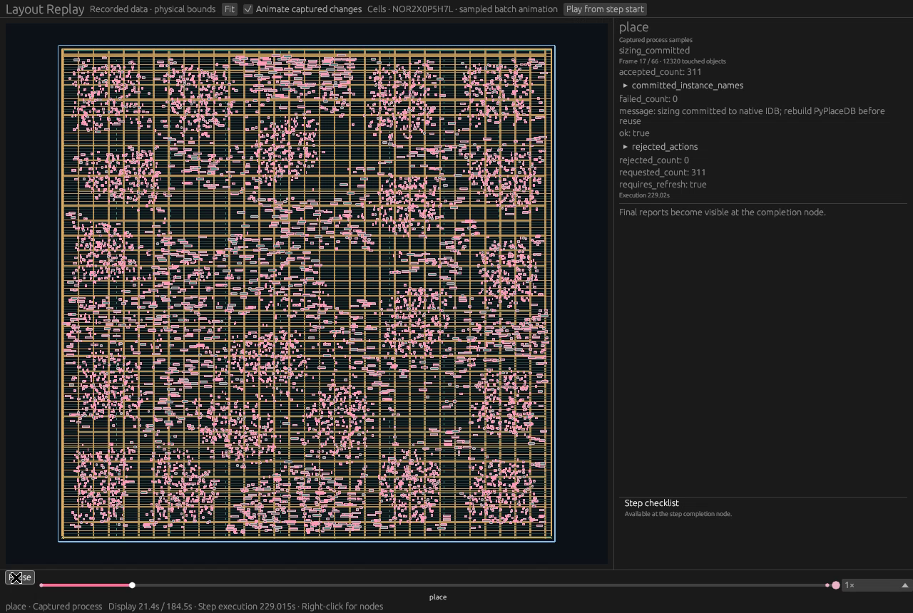

# Change-driven Replay: current implementation

Updated 2026-11-16. This describes source behavior, not a claim that every item
in the broader design has met its acceptance criteria.

## Playback and results

One bottom timeline follows the actual workspace flow. Small circles seek exact
subflow states; large circles select authoritative completed results. The Play
button precedes the bar. Display duration comes from observable changes, not
execution time; original monotonic timestamps remain inspectable. Idle intervals
collapse; phases and metric events remain short nodes. Consecutive compatible
Place samples interpolate over 0.3–1.2 seconds each, with up to 64 movement trails.
Legalization, restoration and structural changes have distinct batch transitions.
Floorplan and routing geometry appear by type, numeric layer and spatial order.
These are presentation effects between recorded facts, not invented tool samples.

Added, moved, resized, reoriented and reconnected instances remain highlighted.
Deleted instances have red outlines/crosses. Completion uses the final committed
scene; interpolated coordinates never alter the recorded metrics or scene.
Place maps automatically follow completion and use a selectable right-side list.
Completed postFloorplan/CTS/filler snapshots embed Native's actual hierarchical
clock graph. Early snapshots default to level, CTS/post-route snapshots to delay
when present. Trees do not appear during physical replay. Tree and report-item
selection locate exact recorded instance/net/pin references; unresolved references
remain visible as missing, not guessed coordinates.

The bottom of the right sidebar contains the frozen checklist. Blocked is red;
other recorded states are green with their original labels. An empty/missing
checklist is identified rather than turned into an invented pass.

Result views include native violation geometry, timing paths, instance power,
net R/C summaries and per-corner SPEF node/resistor networks, solved EMIR node/edge data, Harden LEF pin/OBS overlays and LIB
port/arc metadata. Analysis is bound to the final scene and only shown after
completion. Report-only operations browse actual results without fake cell motion.

## Data lifecycle

ECC now produces `ecos.replay.v2`; Native and Electron also accept existing v1.
V2 declares JSON or gzip+JSON encoding, supports pure-translation deltas with
pin updates, and places checkpoints by byte/depth budget. Sparse checkpoints
explicitly declare `json+base` / `gzip+json+base` and reference the immutable
input checkpoint (index 0); older readers reject this encoding rather than
silently displaying an incomplete scene. Identity includes an
observed birth suffix after deletion/recreation. Large shape identities use a
SHA-256 key; geometry retains layer, net owner, segment width and native pin data.
History remains explicitly sampled; unobserved operations are not inferred.

Tool completion seals the package. Parent flow completion freezes QoR/checklist
and atomically publishes the current pointer with an attempt ID and checksum.
Late workers cannot overwrite a rerun. Disabled capture invalidates older results.
Fresh report checks use a filesystem clock anchor, avoiding client/NFS clock skew.
Frozen report sources, maps and clock-tree side files are inventoried with hashes.
Read-only check failures with valid fresh reports may publish diagnostic-only
results while retaining the failed flow state. Missing/corrupt final data does
not silently substitute an earlier successful recording.

Structural metric deltas are tied to the actual input DEF and matching selector/
unit. Electrical deltas require compatible explicit analysis context. They are
omitted when legacy timing/power reports lack that context.

## Rendering and load behavior

Reconstruction, spatial indexing, tree preparation and report resolution run on
a worker thread. Superseded seeks cannot replace newer requests. Map decoding is
also asynchronous and pauses the display clock while loading. The decoded-frame
cache has an ordinary delta budget (`ECOS_REPLAY_CACHE_MIB`, default 128 MiB,
cap 512 MiB) and at most two oversized full checkpoints. Their additional byte
budget is eight times the ordinary budget, capped at 1 GiB; zero disables both.
Scene/index memory and the input anchor are separate. Immutable object records
and their ordered tables, deletion records and highlight sets are shared across
scenes. A delta validates all translations before mutation, then detaches the
table and only the changed objects when another snapshot still references them.
Consecutive private translations reuse objects and pin attributes. This changes
in-memory ownership only; v1/v2 JSON and gzip captures remain compatible.
The loader pins one immutable input checkpoint and prefetches at most the next
compatible movement while the current animation plays. A new seek cancels old
work; it does not retain every historical scene. Spatial queries exclude unplaced/offscreen geometry.
The spatial tree sorts compact bounds/slots while object references and names
stay in a separate stable array. Tests exercise queries across tree partitions
and swept movement bounds. Highlight membership queries are limited to rendered
instances/macros; the captured touched set itself remains unchanged.

The 2D canvas retains static meshes and updates dynamic objects in compact
batches. Full-chip static subpixel vias use pixel coverage; exact geometry is
retained for zoom/focus and inspection. Dense track grids are hidden at the
full-chip scale. Cache invalidation follows scene, animation, viewport and focus
changes. This is separate from the ordinary layout renderer.

### Snapshot ownership contract

`Scene::apply(&mut self, delta: Delta) -> Result<(), &'static str>` preserves
all existing snapshots. `Scene.objects` and `Delta.upsert` use
`Arc<BTreeMap<String, Arc<Object>>>`; touched/restored sets and deletion tables
also use `Arc`. Serde reads/writes the underlying collections, without adding
JSON wrappers or changing capture schemas, paths, timestamps or cache budgets.
Referenced checkpoints detach the anchor table before merging their overrides.

Translation validation finishes for the entire batch before any mutation:

| Input | Result |
| --- | --- |
| Existing instance/macro with valid coordinates and pins | Move bbox and all pin positions; preserve other attributes |
| Shared table/object | Detach before mutation; cached input and previous scenes stay unchanged |
| Private object in consecutive translations | Reuse its allocation and attributes |
| Absent/non-instance target, upsert/remove conflict, coordinate overflow or invalid pin | Return an error; preserve the complete previous scene |
| Translation in a checkpoint, unresolved base or non-checkpoint revision gap | Reject before changing geometry or highlights |

Do not move objects while validating successive IDs: a later invalid pin must
not leave earlier objects moved. Validate all IDs first, then use
`Arc::make_mut` on the table and changed objects. A full checkpoint shares its
validated table directly. Metric-only deltas leave the object table shared.

Regression assertions cover snapshot bbox/pins, reuse across private moves,
late invalid/overflowing pins and complete scene equality after rejection.
Real-data validation compares sequential and 100 random reconstructions,
including deleted/restored/touched sets. Tiny-via aggregation tests compare the
complete mesh: hash accumulation retains pixel coverage and emits sorted pixel
coordinates for deterministic drawing.

## Reproducible verification

- ECC: `.venv/bin/ruff check chipcompiler test`,
  `.venv/bin/ruff format --check chipcompiler test`,
  `.venv/bin/pytest -q test`: 4469 passed, 6 skipped, 1 deselected, 4 xfailed.
- Native: `cargo fmt --all -- --check`, `cargo test --workspace`,
  `cargo build --release -p chip-viewer-native` (rerun after rendering changes).
- GUI: `pnpm run check`: Electron 1569 passed, 2 skipped; renderer/shared/infra
  checks also passed. Optional real-workspace catalog tests use
  `ECOS_REPLAY_TEST_WORKSPACE`.
- Kepler: `ctest --test-dir build-replay -R '^(ReplayTests|KeplerFormalCliTests)\.'
  --output-on-failure`: 234 passed. New Sizer and ECC-Tools builds succeeded.
- Real isolated GCD: full flow and terminal-Place flow; real AES: 22 stages
  through Harden, including diff_opt/diff_sizing and five DR iterations.
  GCD Harden rerun produced six export boundary events and 11 result views.
- Product GUI/terminal/concurrency E2E journeys passed. The broader accidentally
  selected suite initially failed two dashboard layout assertions. The test
  coordinate origin omitted stable scrollbar gutters; correcting that origin
  (without relaxing the threshold) passed the focused six-case rerun. EMIR's product E2E process fixture is synthetic and is
  not signoff validation.

Opt-in native tests:

```sh
ECOS_REPLAY_TEST_CATALOG=/path/to/ws/home/replay-view.json \
  cargo test --release -p chip-viewer-native \
  real_workspace_random_seek_and_frozen_artifacts -- --ignored --nocapture
ECOS_REPLAY_TEST_CATALOG=/path/to/ws/home/replay-view.json \
  cargo test --release -p chip-viewer-native \
  real_layout_animation_cpu_frame_time -- --ignored --nocapture
```

The first compares sequential reconstruction with 100 random seeks per step,
including highlights/deletions/revision, validates frozen assets, and measures
seek+spatial-index CPU latency. It is not a request-to-visible UI benchmark.
The second measures 120 animation frames at a 1000×800 viewport, including egui
CPU tessellation but excluding GPU submission. First-frame preparation is separate.

A derived-format test on 66 real AES Place frames reduced frame bytes from
2,518,204,395 to 49,055,622 (98.05%). This was a repack of captured data, not an
EDA capture rerun. Legacy-key AES random seek still exceeded the 1 s target;
increasing cache to 512 MiB did not fix it. Rendering initially measured 242.7 ms
P95; retained batches reduced it to 40.4 ms before the subpixel-via optimization.
Fresh producer and final rendering measurements are recorded in the completion
ledger; these preliminary figures do not prove the full performance target.

The current producer was rerun on AES Place: 66 frames, 107,942 objects,
100 random seeks with exact sequential-state comparisons, seek+index P95
923.9 ms and reconstruction P95 844.5 ms. The CPU animation benchmark after
subpixel-via aggregation measured P95 27.5 ms, excluding GPU submission.
These measurements do not establish request-to-visible UI/GPU latency.

Sizer now records bounded CELL accepted/reverted batches separately from committed
OpenDB geometry. Process evidence is expandable in the right sidebar. Legalizers
record actual Greedy/Abacus/retry/restoration/M2 boundaries; packed hybrid vectors
are captured only after restoring the physical node order. Kepler records CEC
solver/output and SEC proof boundaries, available counterexample input traces and
engine-generated logical cone evidence, without guessing physical coordinates.

After successful publication, cleanup retains the current and one previous
completed attempt. Unfinished attempts and symlink targets are never deleted;
cleanup failure cannot invalidate a successful recording.

Outstanding acceptance includes broader macro algorithms/orientations, repeated
capture-on/off overhead comparison, large routing seek latency, and measured GPU/UI
frame time. The installed GCD pair produced identical DEF/non-runtime QoR (8.79%
wall-time increase in one pair).
Capability remains sampled: candidate summaries do not imply a complete database
transaction journal, and private ICS55 RCX internals expose only wrapper boundaries.

Latest installation validation rebuilt the native release and `make build`
(AppImage/deb), then passed `DISPLAY=:189 pnpm run desktop:smoke`. The native
production code is installed at `~/.local/bin/chip-viewer-native`; ECC's local
wrapper selects the rebuilt Replay runtime. A packaged Studio uses its configured
runtime: select the external runtime with `ECOS_ECC_BIN_DIR=~/.local/bin` when
testing these local changes rather than the registry-pinned release.

An additional real macro case passed Synthesis through postFloorplan with two
Harden GCD macros at R0/R180, fixed and placed at the configured coordinates.
Native sequential/random reconstruction agreed for all 18 postFloorplan frames
(17,059 objects; seek+index P95 8 ms). This does not validate every macro algorithm.
Installed Kepler also produced the actual SEC counterexample at cycle 1, two
input frames, output mismatch and golden/revised logical cones.

Fresh installed AES single-route capture: 18 frames, 480,821 objects; 100 random
seeks matched sequential state. Seek+index P95 1525.9 ms (reconstruction 1250.8 ms)
exceeds the target and remains an acceptance gap. A real 200 MHz AES Sizer run
captured four Attack decision batches: 21 accepted and 8 reverted. Other CELL
algorithm branches still require their own real execution evidence.

A 45-second AES Place recording using an RTX 4090 Vulkan backend is available in
`.claude/replay-evidence/completion-20261116/aes-place-gpu.mp4`. Its 30 fps screen
capture is visual evidence, not a GPU frame-time benchmark.


Latest native reader optimization keeps the JSON/gzip persisted format unchanged,
uses pure Rust zlib decoding, directly decodes extensible objects, and bounds
large checkpoint reuse by both count and estimated bytes. The same fresh AES
route sample passed all 100 reconstruction/hash comparisons: seek+index P95
887.2 ms, reconstruction P95 570.0 ms (previously 1525.9/1250.8 ms). The timed Cargo
command, including compilation and the test process, peaked at 2,031,060 KiB RSS.
These are backend measurements, not request-to-visible latency.

`cargo test --workspace -- --test-threads=1` passed 472 tests, with 3 opt-in
benchmarks ignored, after these production changes. A preceding default parallel
run hung inside existing 3D GPU test threads and was terminated; the serial run
executes those GPU tests too. The opt-in real-window benchmark additionally uses
`DISPLAY` and a real catalog, samples 30 seconds of playback and 100 exact seeks,
and reports eframe CPU+render time, active frame intervals, and GPU screenshot
readback latency. Readback includes extra transfer cost and is not a claim about
physical monitor presentation time:

```sh
DISPLAY=:189 ECOS_REPLAY_TEST_CATALOG=/path/to/home/replay-view.json \
  cargo test --release -p chip-viewer-native \
  real_window_gpu_playback_and_seek_readback -- --ignored --nocapture --test-threads=1
```


The GPU path now retains six current mesh slots (base, ghosts, deleted marks,
static highlights, animated geometry, animated highlights). It compiles each
transition once and updates a progress uniform for smooth movement/reveal;
software rendering remains available, as does fallback when vertex storage
exceeds the device limit. Scene/viewport changes replace the buffers. GPU pixel
readback tests check interpolated position, opacity, 2x scale, and both linear
and sRGB render targets. Exact subflow selection now submits one load request,
avoiding an immediately canceled speculative animation.

During optimization the real AES route UI baseline measured P95 213.0 ms active
frame interval, 203.6 ms CPU+render, and 2053.6 ms request-to-readback. Static GPU
retention reduced interval to 34.0 ms; uniform-driven animation measured 7.0 ms
interval and 2.9 ms CPU+render. The six-step AES catalog (playback begins at Synthesis, random seeks cross
steps) measured 3.1 ms interval and 2.3 ms CPU+render; these are not Place-only
measurements. Set ECOS_REPLAY_TEST_STEP=place to measure that stage specifically. These are Xvfb/RTX 4090 Vulkan results at
1280x860 and exclude deliberate loading waits from active-frame samples. Initial
preparation is separate. Seek/readback remained 1550.2 ms (route) / 2072.1 ms
(six-step catalog) before the exact-node duplicate-request fix; final numbers follow below.


Final scope-specific AES Place measurement (`ECOS_REPLAY_TEST_STEP=place`):
30 seconds of playback, active-frame interval P95 3.2–4.6 ms, CPU+render P95
0.8 ms, 100 exact-node requests to GPU readback P95 1.40–1.68 s. Cross-step
six-stage requests measured 2.0–2.26 s. Host compilation/tests shared the machine;
these are not isolated repeated certification runs. Playback improved strongly;
the 200 ms cached / 1 s cross-checkpoint request-to-visible targets remain open.

Final ECC suite: 4469 passed / 6 skipped / 1 deselected / 4 xfailed. Final Rust
workspace: 475 passed / 4 ignored opt-in tests, run serially to avoid the host's
parallel 3D GPU test hang. Exact-node regression also exercises a click on the
currently animating frame. The source GUI native wrapper now uses release builds;
`bash -n ecos/scripts/chip-viewer-native-wrapper.sh` and the repository version
consistency check passed.


Final native installation and product packaging passed: `cargo fmt --all --
--check`, `cargo test --workspace -- --test-threads=1`, `cargo install --path
apps/chip-viewer-native --locked --force --root ~/.local`, owner `make build`, and
`DISPLAY=:189 pnpm run desktop:smoke`. Installed/target/packaged native SHA256 all
match `3f9c50c6fcdfa58832a517945ad85b1ec6c10fdf8765902e241fadb8cc3c70e3`.
Updated visual evidence: `.claude/replay-evidence/completion-20261116/aes-place-gpu-final.mp4`
and its PNG, using a temporary Place-only launch catalog over real captured data;
no flow or capture files were modified. The screenshot was visually reviewed.

GUI checks/E2E and tool-specific suites retain the earlier passing results after
their last relevant changes; they were not repeated for the final native-only
optimization. Linux release packaging was run; macOS/Windows builds were not run
on this host. No toolchain pins or gitlinks were updated.


## Development branch snapshot (2026-11-16)

The current source checkpoint is published on `yell/replay` in the repositories
below. Source integration tests use these revisions; the packaged ECC runtime
provenance lock has not been refreshed from a new successful ECC CI run, so this
Studio checkpoint intentionally does not advance the parent ECC gitlink.

| Repository | Source commit |
| --- | --- |
| ECC | `5cdb3db201761e3becf81db202c529655caa6614` |
| ECC-Tools | `603e6387107d616a500f043d4eb30df7b4bfcbe6` |
| ECC-DreamPlace | `7ca9a885` |
| ECC-Sizer | `8d4c32c` |
| OpenROAD Replay fork | `53d1f1224c` |
| Kepler Formal | `73cc835` |

OpenROAD's original remote rejected writes by the current account. The commit
is published at [Yell-walkalone/OpenROAD](https://github.com/Yell-walkalone/OpenROAD/tree/yell/replay);
Sizer's branch-specific `.gitmodules` URL points there so a recursive checkout
can retrieve it. Other repositories retain their original remotes.

For source testing, fetch/check out ECC's `yell/replay` in the existing ECC
submodule and initialize its pinned submodules; build the matching Sizer and
Kepler branches when testing their new native capture hooks. Existing system
installations on the development host already contain these tool builds.
Published runtime artifacts and a refreshed `.github/ecc-ci-toolchain.json` are
required before advancing the product's packaged toolchain pin.

Real installed AES Place capture with GPU animation and instance highlighting:



## Shared-table and compact-index verification (2026-11-16)

The real-window probe now starts its seek timer immediately before the UI
selection. Reading the manifest solely to choose a test timestamp happens before
that timer; the application's own validation/reconstruction remains measured.
Test-only timings separate reconstruction, index building, result assets,
snapshot handoff and the update that builds the first mesh. These clocks and
diagnostic fields are absent from production builds.

Final serial GPU probes used an AMD EPYC 9654 host, RTX 4090/Vulkan (driver
580.82.07), X11 display `:189`, 30 seconds of playback and 100 exact-node seeks:

| Real capture | Frames / final objects | Active interval P95 | CPU+render P95 | Request → GPU readback P95 |
| --- | --- | --- | --- | --- |
| AES Place | 66 / 107,942 | 3.6 ms | 0.8 ms | 810.8 ms |
| AES Route | 18 / 480,821 | 10.6 ms | 5.5 ms | 857.8 ms |

Place was explicitly scoped with `ECOS_REPLAY_TEST_STEP=place`; its catalog also
contains the preceding five flow steps. Route used its genuine one-step flow.
No flow or captured data was changed. With corrected timing, the initial Place
probe measured 1199.8 ms. Before shared tables/compact index work, the Route
probe with object reuse measured 1178.1 ms. Final worker reconstruction/index
P95 was 609.1/64.1 ms for Place and 372.8/239.5 ms for Route; snapshot handoff
rounded to 0.0 ms. First-mesh update P95 remains 146.6/435.6 ms respectively.
Phase percentiles are independent and must not be added as a total.

These two runs satisfy the ordinary 1 s seek and active-playback 33 ms targets
for these captures. The 200 ms cached-seek target, new cross-step timing,
repeated isolated certification and a new peak-memory measurement remain open.
GPU readback includes screenshot transfer; it is not monitor presentation time.
The earlier 512 MiB Place cache trial did not improve latency, so the default
128 MiB budget was retained.

Both captures also passed 100 random full-state comparisons against sequential
reconstruction, including revision, object attributes/pins, highlights and
deleted/restored records; frozen assets were verified. Final Rust workspace
validation passed 479 tests, with 4 opt-in tests ignored by the ordinary run:

```sh
cargo fmt --all -- --check
cargo test --workspace -- --test-threads=1
cargo install --path apps/chip-viewer-native --locked --force --root ~/.local
```

The opt-in commands above were additionally run for both real captures. Use
`ECOS_REPLAY_TEST_STEP=place` or `route` to scope real-window measurements without
changing the workspace flow. Full-state comparison used a temporary Place-only
launch catalog and the Route catalog. Linux serial testing retains the earlier
host workaround for parallel 3D GPU tests and still runs those tests.

The Linux owner build and Electron smoke test passed:

```sh
CHIPCOMPILER_ECC_SIZER_ROOT=~/.local/share/ecc/tools/ecc-sizer/replay-complete-20261116 make build
cd ecos/gui
DISPLAY=:189 pnpm run desktop:smoke
```

Installed, release-target and packaged Native Viewer SHA256 all match
`1f7061773529a91e4eb2c68013103e64553efecacbfb71c88c87de4bcbb6e230`.
The version consistency check passed. GUI check/E2E, ECC and native tool suites
were not repeated for this native-only follow-up; their earlier passing results
remain recorded above. macOS/Windows builds were not run on this Linux host.
No persisted data, dependency lock, ECC gitlink or packaged runtime provenance
pin changed in this follow-up. Existing captures need no EDA rerun.
