# ECOS Studio User Guide

This guide explains how to use ECOS Studio to implement a chip from RTL to GDS.
It covers managing resources and PDKs, creating projects and workspaces,
running and inspecting the RTL-to-GDS flow from the GUI or terminal, using the
Chip Viewer and built-in Agent, and working with the experimental frontend
(RTL verification) environment.

## Table of Contents

- [Getting Started](#getting-started)
  - [Launching ECOS Studio](#launching-ecos-studio)
  - [Home Screen](#home-screen)
  - [Application Shell](#application-shell)
  - [Menus and Shortcuts](#menus-and-shortcuts)
- [Managing Resources](#managing-resources)
  - [Command Line Tools](#command-line-tools)
  - [Resource Manager](#resource-manager)
  - [MPC Resources](#mpc-resources)
- [Backend Design](#backend-design)
  - [Backend Design Landing Page](#backend-design-landing-page)
  - [Creating a New Workspace](#creating-a-new-workspace)
  - [Creating a Workspace From a Step Output](#creating-a-workspace-from-a-step-output)
  - [Updating a Workspace](#updating-a-workspace)
- [Project Management](#project-management)
  - [Projects and Workspace List](#projects-and-workspace-list)
  - [Creating a Project](#creating-a-project)
  - [Importing Projects and Workspaces](#importing-projects-and-workspaces)
  - [Removing and Deleting](#removing-and-deleting)
  - [Project Analysis](#project-analysis)
  - [Recovery and Background Operations](#recovery-and-background-operations)
- [Workspace Overview](#workspace-overview)
  - [Navigation Sidebar](#navigation-sidebar)
  - [Workbench Layout](#workbench-layout)
  - [Home Dashboard](#home-dashboard)
  - [Timing](#timing)
- [Running the RTL-to-GDS Flow](#running-the-rtl-to-gds-flow)
  - [Starting and Re-running](#starting-and-re-running)
  - [Monitoring Progress](#monitoring-progress)
  - [Cancelling a Flow](#cancelling-a-flow)
  - [Viewing Logs](#viewing-logs)
  - [Advisory Checks](#advisory-checks)
  - [Using ECC in the Terminal](#using-ecc-in-the-terminal)
- [Inspecting Flow Steps](#inspecting-flow-steps)
  - [Checklist Details](#checklist-details)
  - [Reports](#reports)
  - [Layout](#layout)
- [Configuring the Flow](#configuring-the-flow)
- [Chip Viewer](#chip-viewer)
  - [Opening the Chip Viewer](#opening-the-chip-viewer)
  - [Canvas Navigation](#canvas-navigation)
  - [Sidebar Panels](#sidebar-panels)
  - [Analysis Tabs](#analysis-tabs)
  - [Macro Placement Editing](#macro-placement-editing)
  - [Keyboard Shortcuts](#keyboard-shortcuts)
- [ECOS Agent](#ecos-agent)
  - [Chat Panel](#chat-panel)
  - [Guided Setup and Quick Start](#guided-setup-and-quick-start)
  - [Proposals and Confirmation](#proposals-and-confirmation)
  - [Optimizing a Completed Design](#optimizing-a-completed-design)
  - [Agent Sessions](#agent-sessions)
  - [Agent Setup](#agent-setup)
- [Frontend Design (Experimental)](#frontend-design-experimental)
  - [Frontend Landing Page](#frontend-landing-page)
  - [Frontend Workspace Wizard](#frontend-workspace-wizard)
  - [Frontend Workspace Layout](#frontend-workspace-layout)
  - [Step QoR](#step-qor)
  - [Prepare](#prepare)
  - [RTL Review](#rtl-review)
  - [Elaboration (Elab)](#elaboration-elab)
  - [Lint](#lint)
  - [Simulation (Sim)](#simulation-sim)
  - [Cases and Waveforms](#cases-and-waveforms)
  - [Source Editor](#source-editor)
  - [Waveform Viewer](#waveform-viewer)
- [Global UI](#global-ui)
  - [Notifications](#notifications)
  - [Background Tasks](#background-tasks)
  - [Closing Studio](#closing-studio)
  - [Terminal Panel](#terminal-panel)
  - [Theme, Zoom, and About](#theme-zoom-and-about)
  - [Exporting Results](#exporting-results)
- [Troubleshooting](#troubleshooting)
- [Next Steps](#next-steps)

---

## Getting Started

### Launching ECOS Studio

**Linux (AppImage):**

Download the [AppImage](https://en.wikipedia.org/wiki/AppImage) from the
[release page](https://github.com/openecos-projects/ecos-studio/releases/latest).
Use a Linux x86_64 desktop with glibc 2.34 or newer and X11 or Wayland. In the
directory containing the downloaded file:

```bash
chmod +x ./ECOS-Studio*.AppImage
./ECOS-Studio*.AppImage
```

Use the exact filename if several AppImages are present.

For source development, including the optional Nix development shell, follow
the [development instructions](https://github.com/openecos-projects/ecos-studio/blob/main/ecos/README.md#development).
Use the AppImage instructions above for the supported release installation.

### Home Screen

When you launch ECOS Studio, the home screen provides the main entry points.
The screenshots in this guide were captured from the current desktop app using
the GCD design. Paths, installed resources, and measured results will differ
on your machine.

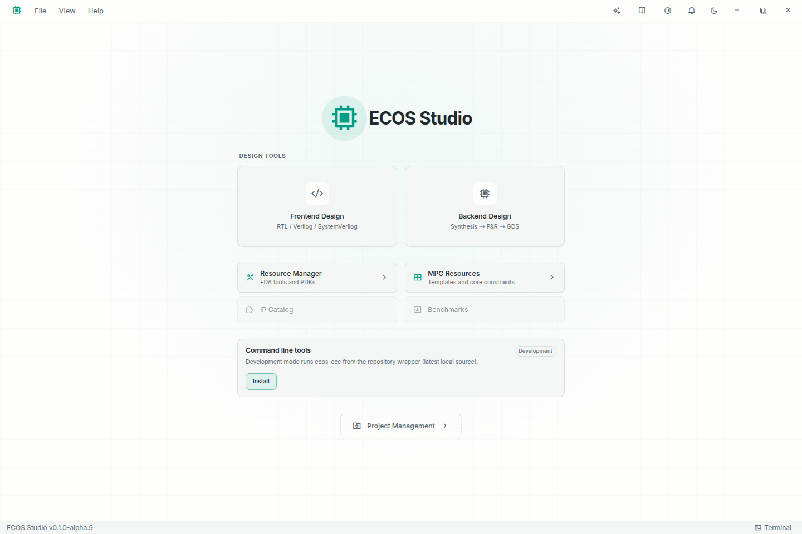

It contains:

**Design Tools** — two entry cards:

- **Frontend Design** — RTL / Verilog / SystemVerilog verification environment
  (review, elaboration, lint, simulation, waveforms). This feature is
  **experimental**: it works, but is under rapid development and may change or
  break between releases.
- **Backend Design** — the main chip implementation tool covering
  **Synthesis → P&R → GDS**. Click this card to enter the backend design
  environment.

**Quick links:**

- **Resource Manager** — install and manage EDA tools, compilers, PDKs, and MPC
  templates.
- **MPC Resources** — browse installed MPC (template and core constraint)
  packages.
- **IP Catalog** / **Benchmarks** — placeholder entries; not yet available.

**Command line tools** — shows the install status of the `ecos-ecc` host CLI
with **Install / Reinstall** and **Uninstall** buttons (see
[Command Line Tools](#command-line-tools)).

**Project Management** — a dashed-outline button at the bottom that opens the
project manager (see [Project Management](#project-management)).

### Application Shell

The application window is organized as follows:

- **Top Bar** — application menu (File / Edit / View / Help), current project
  name, quick actions, notifications, theme toggle, and window controls.
- **Page Content** — the current screen (welcome pages, workspace pages, …).
- **Status Bar** — version text on the left; a **Terminal** toggle button on
  the right that shows or hides the built-in terminal panel.
- **ECOS Agent** — the top bar button shows or hides the Agent. On home
  screens it opens a drawer, initially 280 px wide; drag its left edge to
  resize (280–720 px). On the backend workspace dashboard it opens the right
  panel. The Agent starts hidden when you enter a workspace.
- **User Guide** — the book button in the top bar opens this guide inside the
  application. Drag its right edge to resize it; the main work area uses the
  remaining space. Opening, resizing, and closing the guide keep the application
  window size unchanged. Studio remembers your preferred panel width and caps
  it to leave room for the main work area in smaller windows.
- **Terminal Panel** — a bottom panel with one or more shell sessions (see
  [Terminal Panel](#terminal-panel)).

### Menus and Shortcuts

The application menu lives in the top-left of the top bar. Click a menu to open
it; while a menu is open, hovering another menu name switches to it. Press
`Esc` or click outside to close.

- **File**
  - **New Window** (`Ctrl+Shift+N`) — open a new application window.
  - **New Workspace** (`Ctrl+N`) — open the workspace creation wizard.
  - **Open Workspace** (`Ctrl+O`) — pick a directory and open that workspace.
  - **Update Workspace** — recreate a backend workspace from current project
    settings, or reopen the wizard for a frontend workspace. Read
    [Updating a Workspace](#updating-a-workspace) before using this action: a
    backend update replaces existing execution data. Disabled while a flow is
    running.
  - **Export Signoff Package** _(workspace screens only)_ — review and export
    the sign-off package. Disabled while a flow is running.
  - **Export Design Summary** — export a design summary report.
- **Edit → Config** _(workspace screens only)_ — open the
  [Step Configuration](#configuring-the-flow) dialog.
- **View**
  - **Zoom In** (`Ctrl++`) / **Zoom Out** (`Ctrl+-`) / **Reset Zoom**
    (`Ctrl+0`) — scale the whole UI between 80% and 140%. The setting persists
    across launches.
- **Help**
  - **Documentation** — open this user guide in a browser.
  - **About** — show version information for all components, with a **Copy
    version info** button for pasting into bug reports.

Global shortcuts on Linux:

| Shortcut                       | Action                                        |
| ------------------------------ | --------------------------------------------- |
| `Ctrl+N`                       | New Workspace (open wizard)                   |
| `Ctrl+Shift+N`                 | New Window                                    |
| `Ctrl+O`                       | Open Workspace                                |
| `Ctrl++` / `Ctrl+-` / `Ctrl+0` | UI zoom in / out / reset                      |
| `Esc`                          | Close menus, dialogs, popovers, notifications |
| `Enter`                        | Confirm the default action in dialogs         |

---

## Managing Resources

### Command Line Tools

The **Command line tools** card (on the home screen and in Resource Manager)
manages the `ecos-ecc` host command that exposes the packaged RTL-to-GDS
runtime on your shell.

The built-in terminal provides the command as `ecc`. Studio downloads its
pinned ECC bundle on first use; wait for runtime readiness before creating a
workspace or starting a flow. Installing the host shim lets you run the same
CLI as `ecos-ecc` from a separate system terminal.

- The status pill shows one of: _Unsupported_, _Development_, _Not installed_,
  _Installing_, _Ready_, _Self-check failed_, _Failed_.
- When installed, the card shows the version plus bundle and shim paths.
- **Install / Reinstall** downloads and verifies the bundle (a progress bar
  with percentage is shown); **Uninstall** removes it. Linux only.

### Resource Manager

Open it from the home screen's **Resource Manager** quick link (route
`/tools`). It manages frontend resources, EDA tools, compiler toolchains, PDKs,
and MPC projects.

**Layout:**

- **Close button** (top-left `×`) — return to the home screen.
- **Left navigation** — categories: _All Resources_, _Frontend Flow_, _EDA
  Tools_, _PDKs_, _MPC_, _Installed_, each with a count badge. Selecting
  _Frontend Flow_ also shows a readiness bar (per stage: Review / Elab / Lint /
  Sim / Wave).
- **Need help?** card — links to the user guide.
- **Toolbar** — search box (matches name, description, version, dependencies),
  status tabs _All / Available / Installed / Updates_, and a **Refresh**
  button.

**Resource cards** show an icon, name, description, flow tags, dependency tags
("Installs n required: …"), version, size, and a status pill. Available card
actions depend on the resource and its state:

- **Import Local** — point at a local directory to register a locally built
  tool, or **link a PDK** (files stay in place; the PDK is registered by
  reference).
- **Install** / **Update** / **Replace** (swap a local tool for the managed
  build without deleting the original directory).
- **Cancel** — abort an in-progress installation.
- **Retry** — retry after an error (download failed, verification failed,
  post-install failed, …).
- **Validate** _(PDKs)_ — re-verify PDK integrity.
- **Uninstall / Remove** — uninstalling asks for confirmation because it cannot
  be undone; _Remove reference_ only unlinks a PDK without touching its files.

Use **Install** on a resource card to install it and its required dependencies.
The dependency tags show which additional resources that action will install.

ECC readiness alone does not mean every external EDA tool is available. For
the default full backend flow, install or import Yosys/OSS CAD Suite and the
configured LEC engine (normally Kepler Formal), together with an eligible PDK.
A shorter flow range may require fewer tools. KLayout GUI is needed only when
using `ecc gdsview`.

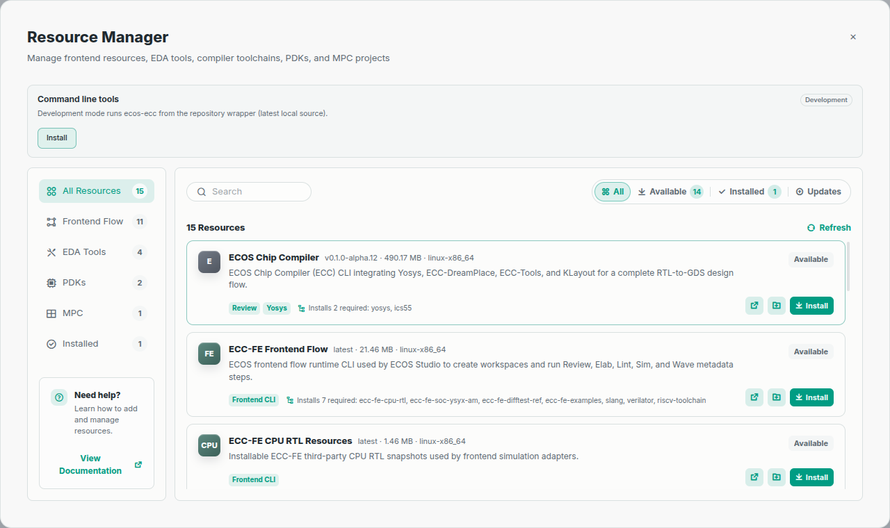

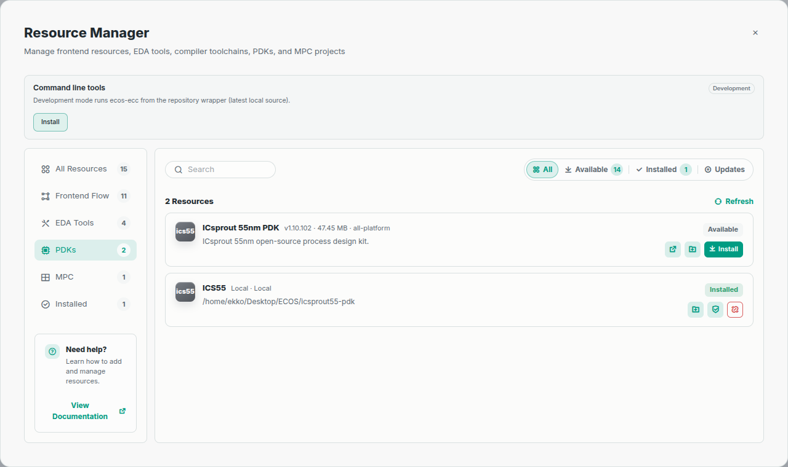

### MPC Resources

Open it from the home screen's **MPC Resources** quick link (route `/mpc`).

- **Manage** jumps to Resource Manager; **Refresh** reloads the list.
- **Left** — installed MPC resources (name + version); click to select.
- **Right** — details for the selected package: version, an _Update available_
  badge when applicable, a **Design** dropdown when the spec contains multiple
  designs, and a template preview showing design information (name, directory,
  DBU, IO pin count), die/core geometry, other resources, I/O metadata, and an
  I/O pins table.
- Empty state links directly to Resource Manager.

---

## Backend Design

### Backend Design Landing Page

Click the **Backend Design** card on the home screen. The landing page offers:

- **Back to ECOS** — return to the home screen.
- **Open Workspace** — pick a directory; the workspace is registered in the
  project-management context and opened.
- **New Workspace** — open the creation wizard (see below).
- **Recent Workspaces** — cards for your most recent workspaces with the PDK
  badge, a status badge (Success / Completed with warnings / Failed / Running /
  In Progress / Not Started), completed step count ("x/y steps"), path, and a
  relative timestamp (Today / Yesterday / N days ago). Workspaces whose state
  cannot be verified show a stale (_Stale · last verified_) badge in amber.
  Hover a card to reveal **×** (remove from the list — files are not deleted)
  and click the card to reopen it. Unrecognized workspaces are greyed out and
  cannot be opened. When there are more than three entries, **View All (N) /
  Collapse** toggles between the short and full list. This list is how you
  _resume where you left off_.

### Creating a New Workspace

Click **New Workspace** to open the wizard. The dialog can be maximized, and
its left step strip lets you jump back to any step you have already reached.
The wizard has seven steps. The example below starts from a project created
in Project Management, so its project directory and imported RTL are already
available:

**Step 1 — Project Setup.** Choose how to anchor the workspace:

- **Select Project** mode — pick an existing **Project Root** (read-only field,
  click it or **Browse** to choose a directory), optionally pick from the
  **Recent Projects** list, and set the **Project Name**.
- **Create Project** mode — enter a **Project Name** and a **Project Parent
  Path** (click or **Browse** to choose).
- A preview card shows the resulting project path and the location of
  `project.json`.

Names must not contain spaces or Chinese characters.

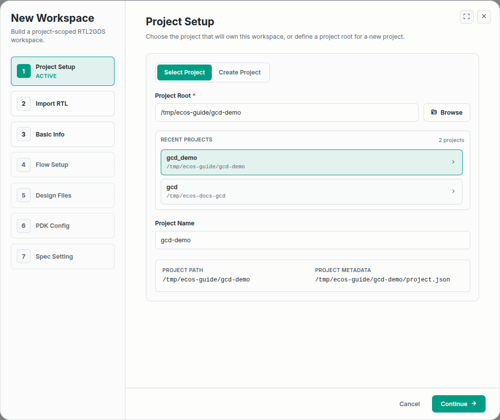

**Step 2 — Import RTL.** Select RTL files or a filelist. ECC copies the selected
sources into the project's `rtl/` directory and records the design inputs at
creation. You can reuse an existing project's imported sources; selecting new
sources replaces that selection. A managed MPC can supply the project design
source. Complete this phase before choosing the remaining workspace settings.

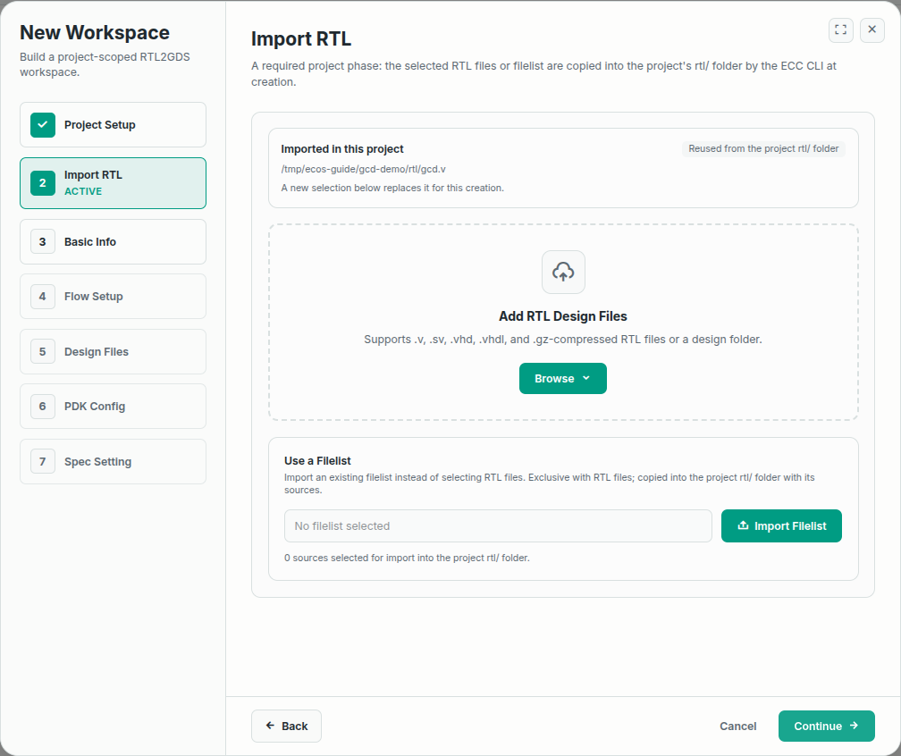

**Step 3 — Basic Info.**

- **Workspace Name** (required; must not contain spaces or Chinese characters;
  is proposed automatically, such as `ws_0001`).
- **Description** — optional free text, stored in `params.toml`.
- **Workspace Location** — read-only preview of where the workspace will be
  created (`<project root>/<workspace name>`).

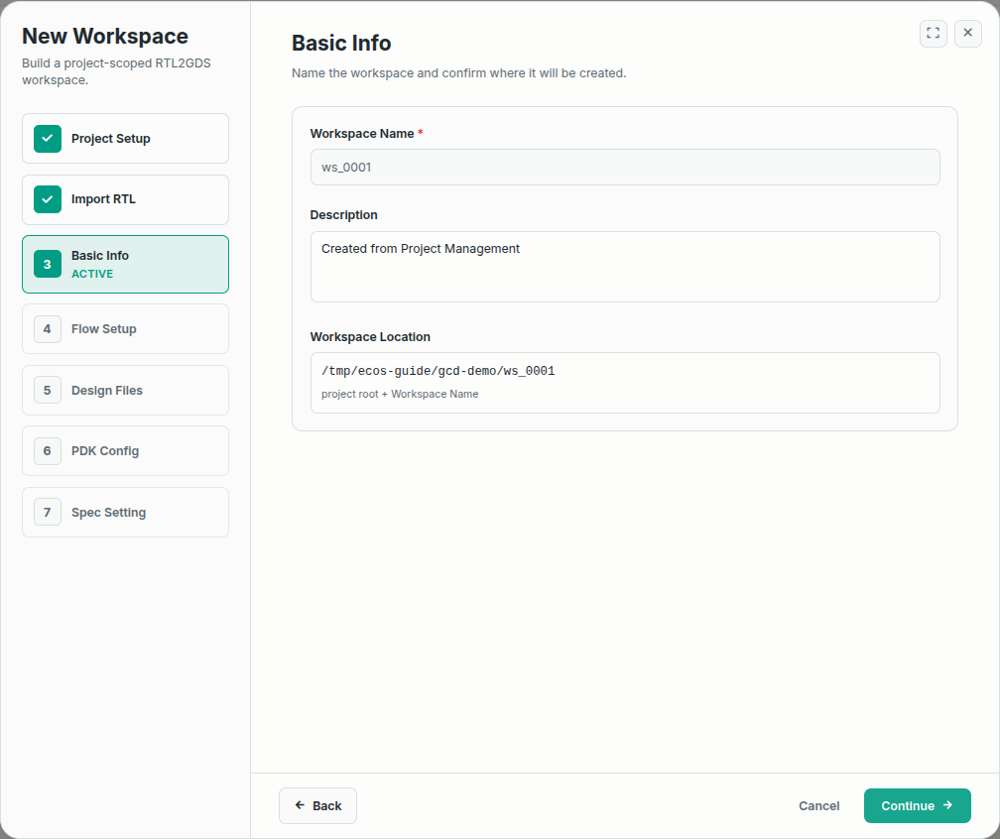

**Step 4 — Flow Setup.** Define the execution range of the RTL-to-GDS flow:

When the range includes STA, **STA maximum parallel corners** selects an integer
from 1 to 4 (default 1, serial). ECC stores `sta.max_parallel_corners` in
`home/params.toml`. The runtime may use fewer workers when CPU or memory is
limited. Keep the setting at 1 for large designs or constrained hosts.

- A summary strip shows the selected **Start Step**, **End Step**, and step
  count.
- Click a step card to set the range. Steps are marked _Reused from source_
  (locked, when deriving from another workspace), _Skipped by default_, and
  _Skippable_.

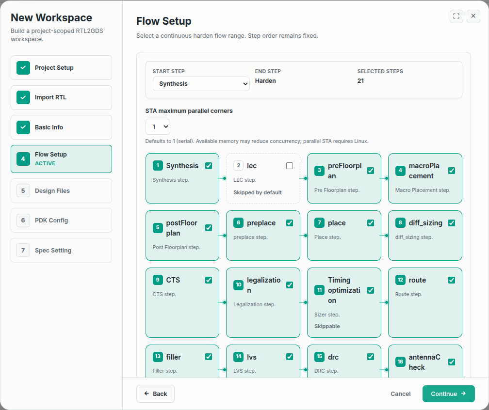

**Step 5 — Design Files.** The inputs depend on the start step (the left rail
lists what is required and what is complete):

- Start at **Synthesis** — review the sources from **Import RTL** and add an
  optional **SDC**. Use **Change in Import RTL** to change the source selection.
- Start at **preFloorplan** — **Verilog** netlist (required) + optional SDC.
- Start later — **DEF** (required) + **Verilog** (required) + optional SDC.
  Each single-file input has an **Import …** button that opens a filtered file
  dialog.

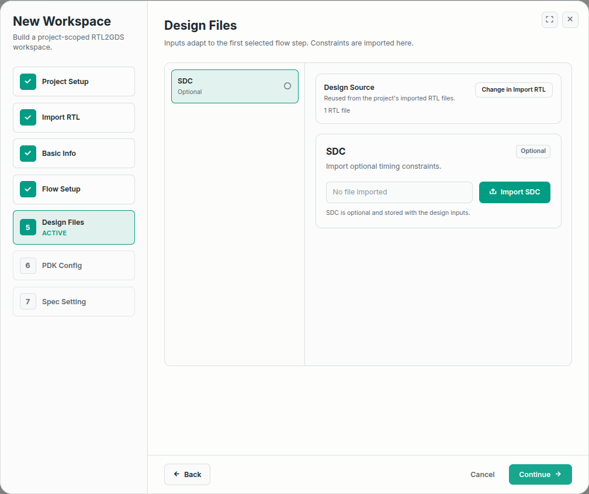

**Step 6 — PDK Config.**

- Pick a **Process Design Kit** from the imported PDK cards (name, node,
  source, version, and a readiness badge: ready / unverified / missing /
  invalid; unqualified PDKs cannot be selected). Card actions: **Re-check
  PDK**, **Locate** (when files are missing), **Remove PDK** (hover, when not
  selected), and **Import PDK** at the top.
- **PDK Path** shows the PDK declared in the project `ecc.toml`; a mismatch
  raises an amber warning.
- **External PDK Paths** lets you add project-level extra macro LEF / liberty
  pools that take part in manual resource picking.
- **Config Mode** — **Default Config** (ECC's default layout; requires a ready
  PDK that supports ECC defaults) or **Manual Config** (pick your own Tech LEF,
  Cell LEF, and Liberty files via the resource picker). Three requirement
  indicators show whether PDK selection, PDK eligibility, and the chosen config
  mode are satisfied.

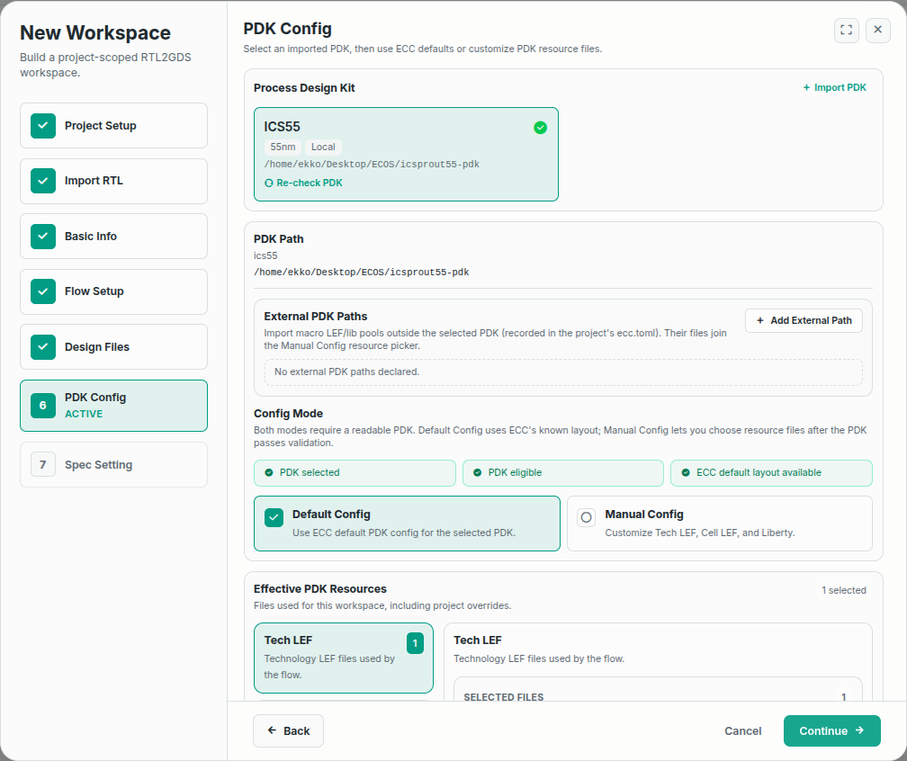

**Step 7 — Spec Setting.** Stored in the workspace `home/params.toml`:

- **Design Name** (required; read-only if the project already declares one),
  **Top Module** (discovers candidate modules from your imported RTL/netlist and
  suggests them; a **Return to Design Files** shortcut appears when discovery
  finds nothing), **Clock Signal Name** (required), **Frequency max [MHz]**.
- **Max Fanout** and the applicable design constraints. After creation, use
  **Edit → Config** to change step-specific parameters such as placement density.
- **Die Area** — either explicit **Width × Height**, or **Core Utilization**.
  With an MPC template, die-area limits are validated live.

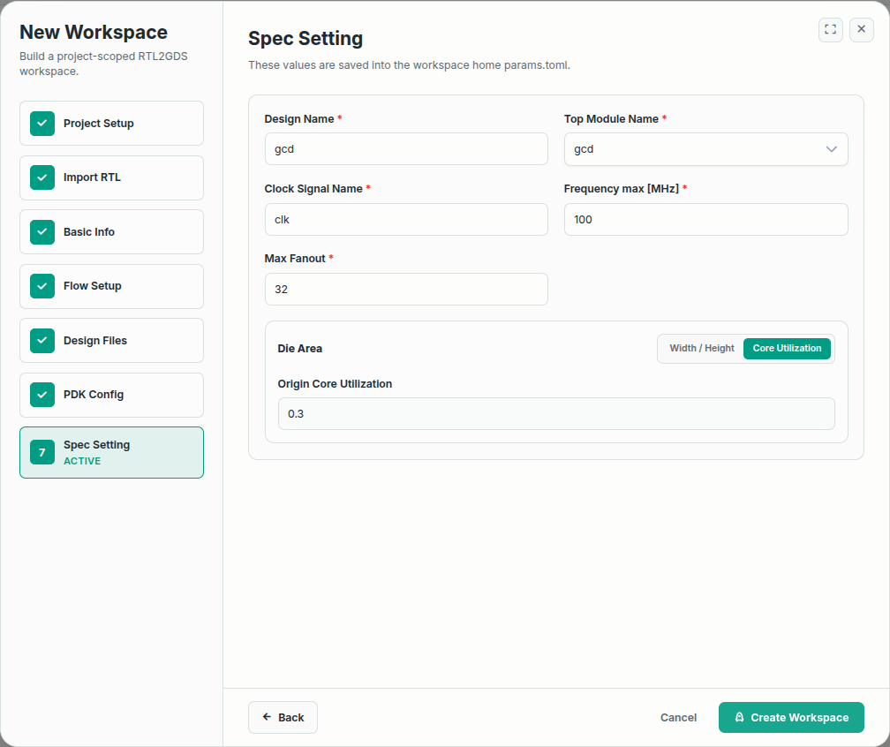

Click **Create Workspace**. ECOS Studio creates the directory structure,
generates configuration files, initializes the workspace database, and
registers the workspace in the project `project.json`. The Step Configuration
dialog may open automatically afterwards so you can fine-tune parameters.

### Creating a Workspace From a Step Output

Project Management can fork a new workspace from an existing workspace's step
output (see [Create from output](#projects-and-workspace-list)). In that case
the wizard is prefilled:

- A **Created from** card on the left shows the source project, workspace, and
  step.
- **Flow Setup** starts at the next runnable step; earlier steps are shown as
  reused and cannot be selected, and the start step is pinned to that next
  runnable step.
- **Design Files** reuses the source: DEF comes from the selected step output;
  Verilog and SDC default to the source workspace configuration.
- **PDK Config** and **Spec Setting** default to the source workspace's
  selection and parameters.

### Updating a Workspace

For a backend ECC workspace, **File → Update Workspace** applies the current
Project design inputs, PDK, and flow selection through `ecc workspace refresh`.
Workspace-local parameter overrides are preserved; edit them separately in the
parameter UI. **Back up the workspace before updating:** refresh replaces the
workspace directory with a fresh generation, removing its previous flow state,
outputs, logs, and user-added files. The new generation must be run again. The
backend GUI action does not offer a backup choice.

To retain the old generation, use the terminal instead:

```bash
ecc workspace refresh ws_0001 --project /path/to/project --keep-backup
```

ECC retains the replaced tree in a sibling `.ws_0001.replace-backup-N` directory
and registers it as an archived workspace in `project.json`. If derived
`config/*.json` files were edited by hand, refresh refuses the overwrite until
you explicitly approve it; the GUI asks before retrying. The operation is
disabled while a flow is running.

For a frontend workspace, **File → Update Workspace** re-opens the workspace
wizard. Before replacing it you choose how to treat the existing data:

- **Cancel** — abort.
- **Do Not Backup** — replace directly.
- **Backup Original** — keep a full backup in Project Management before the
  update replaces flow state, results, artifacts, logs, and user files.

Frontend update is also disabled while a flow is running.

---

## Project Management

Click **Project Management** on the home screen, or **Back to Project
Management** in the workspace shortcuts menu `⋯`. The manager has a
project/workspace tree on the left and an analysis panel on the right. Returning
to it from a workspace keeps that workspace's execution running.

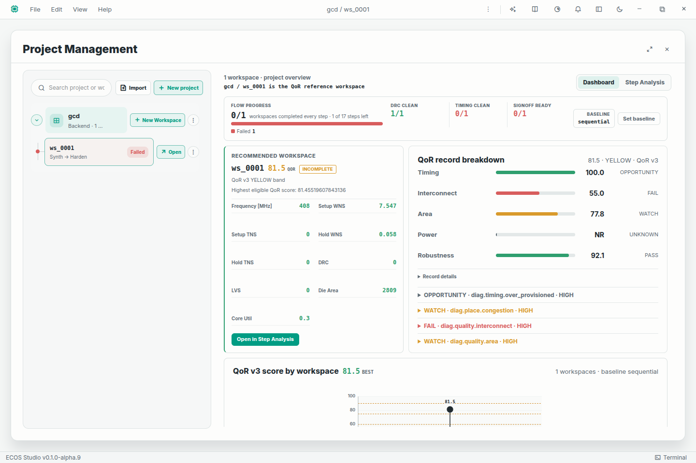

### Projects and Workspace List

**Toolbar:**

- **Search** — matches project and workspace names, paths, top module, PDK,
  workspace IDs, steps, and statuses. Searching automatically expands matches.
- **Import** — pick a directory containing a `project.json` to register an
  existing project (a toast explains if the directory is not a valid project).
- **New project** — create a project (disabled while the app is shutting down).

**Project rows** (sorted by last opened, 20 shown by default with **Show all /
Show fewer**):

- Click the **▸/▾** arrow to expand/collapse the workspace tree.
- **New** — create a workspace under this project (opens the wizard with the
  directory locked to the project).
- **⋯** — **Import workspace** (register an on-disk workspace into the
  project's `project.json`; already-registered workspaces are reported),
  **Check project** (backend projects only; explicitly run the full consistency
  check and show repair actions for any findings), or
  **Remove project** (removes the project from the list only — files stay on
  disk and can be re-imported).

**Workspace rows** show the workspace ID, its step range
(`startStep -> endStep`), provenance (`from <workspace> / <step>` when derived),
and status: while executing, the current operation and a running/queued/
cancelling badge; otherwise the current flow status.
Running backend rows name the actual executing flow step, for example
**Synthesis running** or **macroPlacement running**, and update as the flow advances.

Backend flow status is loaded only for displayed workspace rows. Collapsed
projects and rows hidden by the preview limit do not load their flow files;
expanding them loads their current state. Displayed rows update when their flow
files change. Unreadable or missing state shows **Status unavailable**, while
an unfinished execution whose process is gone shows **Interrupted**. Browsing
the list does not run a full consistency scan or repair workspace state.

- **Open** — open the workspace.
- **⋯** — **Create from output** or **Delete workspace** (red).
- **Create from output** opens a popover listing all committed steps and their
  status. Steps that completed with a Verilog output can be clicked; a
  confirmation dialog shows the target path and the input artifacts (source
  output, DEF, Verilog, SDC). **Continue** opens the prefilled wizard (see
  [Creating a Workspace From a Step Output](#creating-a-workspace-from-a-step-output)).

### Creating a Project

The **New project** dialog asks for:

- **Project Name** and **Design Name**.
- **Project Type** — Backend or Frontend. The workspace wizard follows the
  selected project type.
- **Project Storage Location** — read-only field; click it or **Browse** to
  choose a directory.
- **Managed MPC** — optionally bind an installed MPC template (_No MPC_ or a
  template from the dropdown). Templates with multiple designs show an **MPC
  Design** selector and a preview card. This field applies to backend projects.
- **Import RTL** — required for a backend project without a managed MPC.
  Select RTL files or a filelist; `ecc rtl import` copies them into the
  project's `rtl/` directory.

The dialog previews the manifest path (`<location>/project.json`) and validates
the inputs inline (missing directory, unloaded MPC spec, …). **Create** writes
the backend project's `ecc.toml` and `project.json`, imports its RTL, and
registers the project. Creating a project does not run its flow; use the
project row's **New** action to create a workspace next.

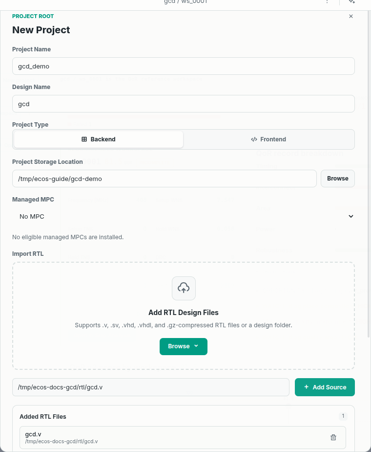

### Importing Projects and Workspaces

- **Import project** (toolbar) — register an existing project directory.
- **Import workspace** (project row `⋯`) — register a workspace directory into
  a project.

### Removing and Deleting

- **Remove project** — unregister from the list; nothing is deleted from disk.
- **Delete workspace** — opens a confirmation dialog with **Keep workspace
  data** checked by default. Confirming this default removes its registration
  from `project.json` and leaves the directory on disk. Clear the checkbox to
  also permanently delete a workspace directory inside the project.
- External workspace directories always retain their data; the dialog removes
  their registration only.

### Project Analysis

The right panel analyzes the selected project or workspace. It has two tabs
(**Dashboard** / **Step Analysis**; `←`/`→` and `Home`/`End` switch tabs).

**Dashboard tab:**

- **Project health** — flow progress bar with per-status counts, sign-off
  readiness cards, and a **Set baseline** button that marks the selected
  workspace as the QoR baseline (two-click Confirm/Cancel because it writes
  `project.json`).
- **Recommended workspace** — the best candidate with its QoR score, sign-off
  label, rationale, and PPA metrics; click its ID to select it or **Open in
  Step Analysis** to drill down.
- **QoR record breakdown** — per-dimension scores with expandable diagnostics
  (status, confidence, severity, evidence, suggested intervention, validation
  requirement) and record details (evidence completeness, feasibility gates,
  power).
- **QoR trend chart** — a lollipop chart of QoR scores across workspaces with
  the baseline highlighted; click a point to select that workspace.
- **Workspace comparison** — a sortable table (click any column header to
  toggle ascending/descending) with a search box, an **Attention only** filter,
  and **Reset**. Columns include workspace (with best/baseline badges),
  progress, QoR score, blocking issue counts, sign-off readiness, and per-metric
  columns. **Debug** jumps to Step Analysis.
- **Needs attention** — project-level risks and regressions (severity tags such
  as CRIT/WARN, workspace/step, title, details). Click a row to drill into the
  corresponding step/metric. Shows 6 by default with **Show all / Show fewer**.

**Step Analysis tab** — step-level comparison across workspaces: step
comparison charts, per-workspace summaries, QoR trends, and selectable issue
metrics.

### Recovery and Background Operations

Conditional panels above the analysis view:

- **ProjectComparisonRefreshStatus** — when automatic refresh is unavailable, a
  warning with a manual **Refresh** button.
- **Project Background Operation** — when the selected workspace has a queued,
  running, or cancelling background operation (step run or full flow), with
  **Cancel**, **Retry Snapshot** (on snapshot failure), and **Open Workspace**
  actions.

---

## Workspace Overview

Open a backend workspace to land on its dashboard. The Flow diagram is the
main place to run steps and inspect their results.

### Navigation Sidebar

The left rail contains **Dashboard**, **Step Trends**, **DB Trends**,
**Congestion**, **DRC**, and **Timing**. The analysis entries open dialogs over
the dashboard. Select individual flow steps through the diagram's cards.

### Workbench Layout

The dashboard fills the workspace while Agent is hidden. Use **ECOS Agent** in
the top bar to show its panel on the right; the initial split gives it 25% of
the workbench width. Drag the divider to adjust it. Hiding Agent removes that
panel and divider so the dashboard fills the available width again.

The separate **Show/Hide information panel** top-bar control also affects the
right panel. If Agent is enabled but its panel is not visible, check that
**Show information panel** is selected.

### Home Dashboard

- **Flow diagram** — each card shows the step's execution state, elapsed
  runtime, peak memory, checklist state, and layout thumbnail when available.
  The status icon opens a step-run dialog; **Details**, **Reports**, and
  **Log** open that step's results. The diagram groups post-route checks into
  branches. Use the zoom slider, wheel, or drag to navigate, and the expand
  button to view the diagram full screen. Branches describe the displayed
  dependencies; they do not promise that the checks execute in parallel.
- **Quality of Results** — the current QoR v3 score out of 100, or **NR** when
  the design is not rated. **QoR details** opens the full assessment and any
  available baseline comparison.
- **Signoff Checklist** — pass rate and passing, blocked, warning, and
  unavailable counts. **Sign-off details** lists the findings and evidence.
- **Signoff card** — after Harden, **Review & export** becomes available when
  mandatory verification steps and their checklists pass. Review the package
  before exporting; a completed runtime step alone does not certify signoff.
- **Chip Basic Info** — project, SoC template, workspace, PDK, design, top
  module, die area, frequency, clock, and applicable constraints.
- **Key Metrics** — area, instances, timing, and other available results.
- **Stale-result notice** — identifies results from an earlier configuration.
  They remain available for inspection but do not count as current signoff
  evidence.

Use the sidebar analysis dialogs for runtime and peak-memory trends, database
metrics across steps, congestion maps, DRC statistics, and timing details.
Missing results show their availability instead of a fabricated zero.

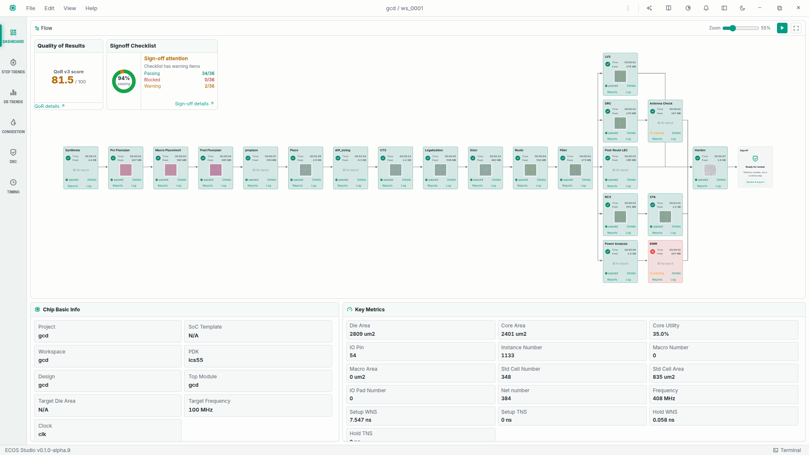

In this example, Harden succeeded while EMIR remains incomplete because no
process technology file was configured. The warning remains visible in the
checklist; see [Advisory Checks](#advisory-checks).

### Timing

Open **Timing** from the left rail to inspect the current workspace’s STA
results by corner and path group.

- **Overview / Summary** — separate worst setup/hold WNS and TNS KPIs (also
  present in the compact Synthesis/STA summaries), with each metric's own
  worst corner; the minimum available frequency across
  corners, and a per-corner WNS/TNS/NVP table. Times are in ns; frequency is in
  MHz. NVP is the number of violating paths. Missing corner data stays visible
  and cannot be interpreted as a passing result. A path-group selector and
  negative-first sorting help focus the overview.
  Red cells trace the Worst row back to its source corner values, including
  ties; this provenance marker is not itself a violation indicator. NVP is a
  total across corners, so its non-zero contributors are highlighted instead
  of inventing a single worst corner.
- **WNS / TNS by Corner** — switches the same chart between worst slack and
  total negative slack. Both modes show setup and hold series in ns, with a
  zero reference line; unavailable values are gaps, not zero-valued passes.
  Expand the chart when needed. The corner table scrolls with pinned column
  headers and a Worst row so path selection remains easy to reach.
- **Timing paths · corner** — selects the corner to inspect, initially the
  worst setup corner. Setup and hold paths are sorted by lowest slack first.
  Each compact path row shows slack, endpoints, path group, and stage count;
  expand it for a delay waterfall and a scrollable pin/cell/delay/arrival table.
  All exported paths for the selected corner are available, including paths
  with positive slack; Run Information states the tool's export limit and the
  setup/hold path counts.
- **View full timing issues with stages** — separately loads the analysis
  issue list. An empty issue list does not imply an empty timing-path export.
  Zero issues, missing paths, and artifact errors have distinct messages.
- **Reload timing** refreshes corner summaries, paths, and issues. Rerunning
  or updating the workspace refreshes these results automatically. Missing
  or changed artifacts remain unavailable until current results can be read.

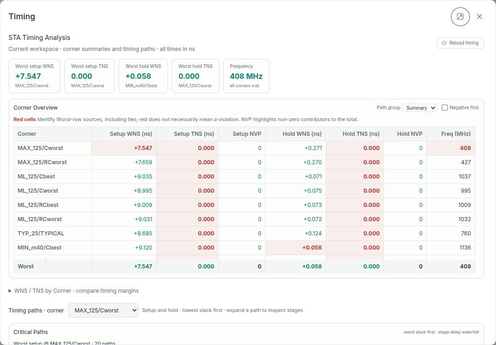

---

## Running the RTL-to-GDS Flow

The workspace's stored flow determines its step list and order. New default
flows include the post-route sequence `route → filler → lvs → drc →
antennaCheck → postRouteLec → RCX → sta → powerAnalysis → emir → Harden`.
Existing workspaces retain their stored sequence.

### Starting and Re-running

- Use **▶ Run** in the Flow diagram header to run the full flow.
- Click a step card's execution-state icon to open its run dialog and run
  that step.
- Finished flows and steps ask for confirmation before rerunning. A rerun can
  invalidate dependent downstream results; read the confirmation first.
- The Run control shows a spinner while that workspace is busy. Runs started
  through the built-in terminal update the same control.
- Close an open Chip Viewer for the affected step before rerunning it. Run
  stays disabled while the Viewer is saving edits.

Separate workspaces can run concurrently, including workspaces within one
project. Use **Background Tasks** to track them. Each flow uses its own
workspace state; avoid starting a second run against the same workspace and
allow enough RAM and CPU for overlapping native tools.

### Monitoring Progress

Execution state and checklist state answer different questions:

| Display                     | Meaning                                                                    |
| --------------------------- | -------------------------------------------------------------------------- |
| Execution icon / card color | Whether the step is pending, running, succeeded, failed, or skipped        |
| Checklist label             | Whether its evidence is passed, blocked, warning, or unavailable           |
| Signoff summary             | Whether the required verification and delivery checks are ready for review |

For example, EMIR can have a red execution icon and a yellow checklist warning
because it failed as a nonblocking advisory check. Antenna Check can execute
successfully and still require coverage review.

The dashboard, **Background Tasks**, and visible workspace rows in **Project
Management** follow the current execution. You can return to Project Management
without stopping the flow. CLI runs against that workspace also update these
surfaces; you do not need to reopen the workspace to see progress.

### Cancelling a Flow

There is no pause. To stop a running flow, open **Background Tasks** in the top
bar, find the workspace task, and click **Cancel Flow**. The runtime stops at
its supported cancellation boundary. Cancelling one workspace does not cancel
other workspaces' flows. Backend ECC flows run independently of the Studio
window; closing Studio does not cancel them. Cancel explicitly and wait for the
terminal state when you want execution to stop.

### Viewing Logs

Click **Log** on a flow step card to open its log dialog. The viewer groups
output by step and tool and supports copying, expanding, and following the
latest output. It follows the tail only while you are near the bottom, so you
can scroll up to read earlier messages. Errors and warnings have distinct
colors; the editor's context menu provides Copy and search actions.

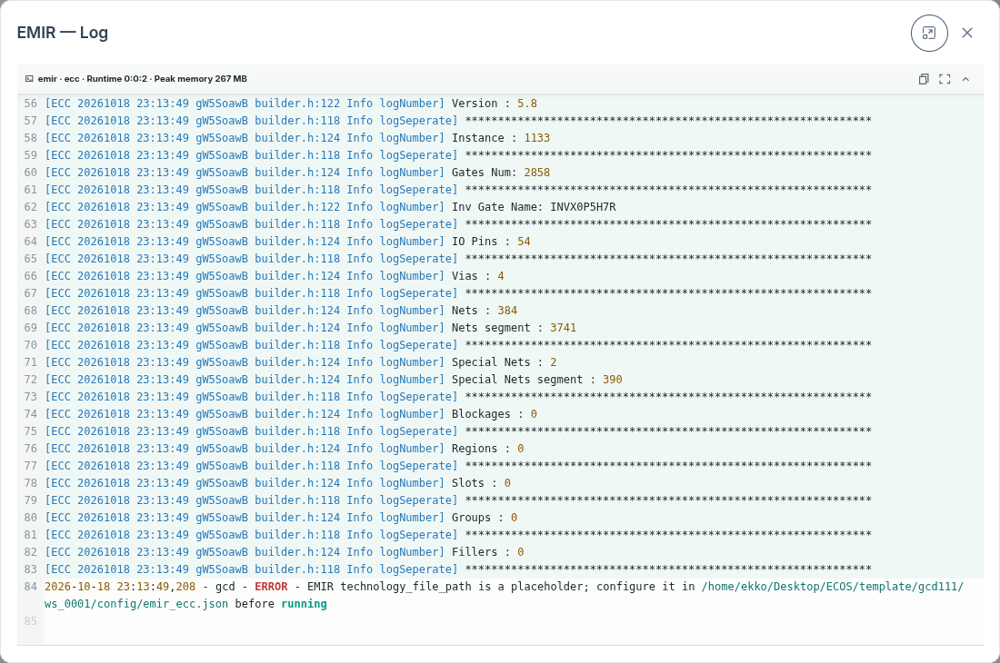

### Advisory Checks

**Antenna Check** and **EMIR** are advisory. Their failures retain the real
execution status and appear as checklist warnings, while later steps such as
Harden may still complete. Review their logs and coverage before treating the
results as verified.

- **Antenna Check** reports antenna violations without repairing them. Some
  PDK inputs lack antenna rules or gate-area annotations. A successful
  invocation can therefore leave the design without antenna-check coverage.
- **EMIR** needs a real process technology file. The default
  `emir.technology_file_path` is empty; without it, EMIR reports `Incomplete`.
  Set it on an existing workspace through **Edit → Config → EMIR**, or use:

  ```bash
  ecc param set emir.technology_file_path /absolute/path/process.tech \
    --project /path/to/project --workspace ws_0001
  ecc run --project /path/to/project --workspace ws_0001 --only emir --force
  ```

Changing a workspace parameter invalidates the owning step and its suffix.
Running only EMIR leaves later steps to be rerun separately; continue the flow
with `ecc run --project /path/to/project --workspace ws_0001` when needed.

ECC's `test/fixtures/emir/ics55_synthetic.tech` is synthetic data for CI and E2E
execution tests. Normal projects do not select it automatically, and its
numerical results are not foundry signoff evidence.

### Using ECC in the Terminal

Open **Terminal** from the status bar. The built-in shell provides `ecc` with
Studio's tool environment. In a separate host shell, the installed shim is
named `ecos-ecc`; substitute it for `ecc` in these examples.

This example creates a backend GCD project and workspace. Replace the RTL,
PDK, and process technology paths with your own inputs. If you do not have an
EMIR technology file, omit that parameter command and expect the advisory
warning described above.

```bash
ecc init /path/to/gcd-project --project-name gcd --design-name gcd
cd /path/to/gcd-project
ecc rtl import --verilog /path/to/gcd.v
ecc pdk set-root /path/to/icsprout55-pdk
ecc project set design.top gcd
ecc project set design.clock_port clk
ecc param set design.frequency_mhz 100
ecc param set floorplan.core_util 0.6
ecc param set place.target_density 0.2
# Configure this before creating the workspace if you will run EMIR.
ecc param set emir.technology_file_path /path/to/process.tech
ecc workspace create ws_0001
```

In Studio, import the project through **Project Management**, then open
`ws_0001`. Keep the dashboard visible and start its flow from the terminal:

```bash
ecc run --project /path/to/gcd-project --workspace ws_0001
```

The diagram and Run control reflect the CLI run. The project manager's visible
workspace row follows the current step and final outcome. Workspace creation
and flow execution are separate operations; `ecc workspace create` does not
start the flow.

For an existing workspace, use explicit selectors to avoid running against a
different project or workspace:

```bash
# Inspect current state.
ecc status --project /path/to/gcd-project --workspace ws_0001
# Continue from the first unfinished step.
ecc run --project /path/to/gcd-project --workspace ws_0001 --resume
# Rerun exactly one step, even if it previously succeeded.
ecc run --project /path/to/gcd-project --workspace ws_0001 --only route --force
```

A project-level `ecc param set` supplies defaults for future workspaces. Add
`--workspace ws_0001` to edit an existing workspace. ECC stores its parameters
in `home/params.toml` and derives `config/*.json` from them. Direct edits to
generated configuration can be replaced by refresh or rerun.

`--no-wait` makes commands fail promptly when a required mutation lock is busy;
it does not detach the flow or launch a background job. For concurrency, open
another terminal session and run a different workspace.

---

## Inspecting Flow Steps

Use the actions on a step's Flow diagram card to inspect it without leaving
the workspace dashboard.

### Checklist Details

**Details** opens the step's checklist findings, including state, summary, and
source. Expand the available evidence to inspect its content. Use the overall
**Sign-off details** link to review findings across the whole workspace.

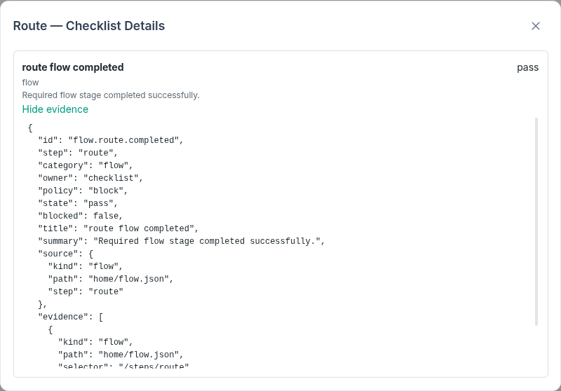

### Reports

**Reports** opens a file list and text preview. Select a report, use **Refresh
reports** to reload the list, or maximize the dialog. Large reports show a
truncation notice when the preview reaches its limit.

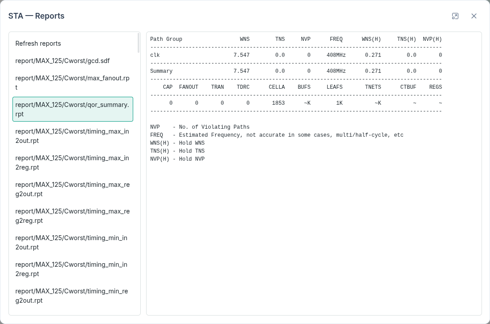

### Layout

Click an available thumbnail to open the saved step geometry in Chip Viewer.
A step may legitimately have no layout, for example a report-only check.
Missing or stale geometry has an explanatory tooltip and cannot be opened as
current layout data. Use **Edit → Config** for step parameter changes and the
sidebar analysis dialogs for cross-step results.

---

## Configuring the Flow

Open **Edit → Config** from the workspace menu. Select a step in the left
**Flow steps** list to edit its parameters. The list comes from the current
flow and ECC's parameter catalog; Floorplan groups its shared settings.

- Parameter types determine the editor: text, number, checkbox, array, or
  object fields.
- **Reload** reads the persisted values, **Reset** discards the draft, and
  **Save** applies changes to the current workspace. An `*` marks unsaved
  changes; switching steps asks before discarding them.
- Saving requires the current workspace revision and is blocked while that
  workspace's flow is running. A conflicting edit is reported rather than
  silently overwritten.
- ECC persists workspace parameter overrides and regenerates the affected
  configuration. Changing parameters can invalidate previous results; rerun
  the affected steps before reviewing signoff.

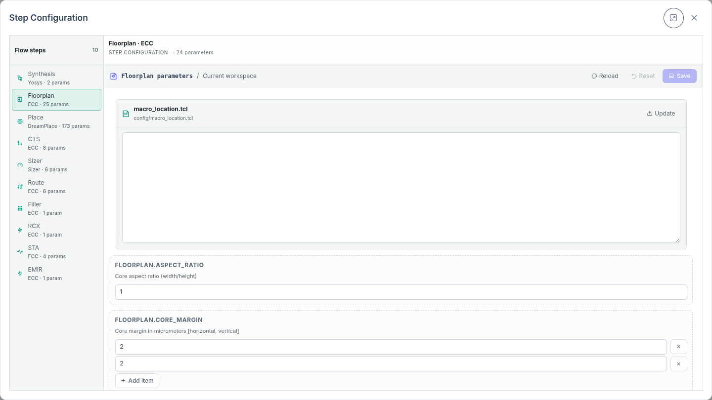

Use `ecc param set KEY VALUE --project DIR --workspace NAME` for the same
workspace parameter workflow in the terminal. Omit `--workspace` only when
setting defaults for newly created workspaces.

---

## Chip Viewer

The Chip Viewer is a native (GPU-accelerated) window for viewing and editing
layouts — large layout data stays out of the Electron renderer.

### Opening the Chip Viewer

Click a step card's layout thumbnail in the Flow diagram. The viewer opens the
saved geometry snapshot for that step.

You can also use the built-in terminal:

```bash
ecc chipview --project /path/to/project --workspace ws_0001 --step route
ecc gdsview --project /path/to/project --workspace ws_0001 --step Harden
```

`chipview` opens saved geometry in the native Chip Viewer. `gdsview` opens an
available GDS in KLayout and requires the KLayout GUI. A step needs the
corresponding output files before either command can open it.

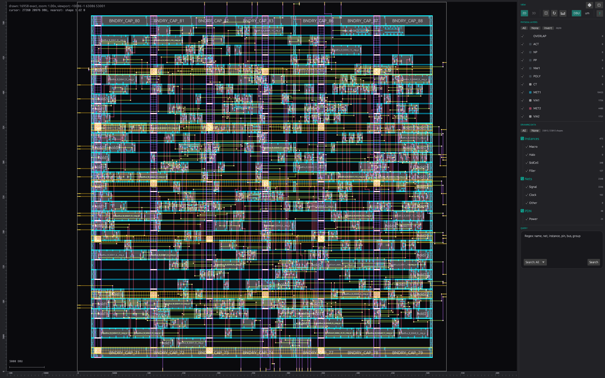

The screenshot uses the software renderer in a virtual machine. Hardware GPU
availability determines whether 3D mode is offered.

### Canvas Navigation

- **Mouse wheel / trackpad pinch** — zoom at the cursor.
- **`+` / `-`** — zoom around the viewport center.
- **Left-drag in 2D** — pan. In 3D, left-drag orbits and middle/right-drag
  pans. **Arrow keys** — pan by 10%.
- **`F` / `Home`** — fit the whole layout.
- **`Q`** — toggle 2D / 3D. In 3D: `1`/`T` top, `2`/`I` isometric, `3` front,
  `G` grid, wheel dollies the camera. 3D presets (Iso / Top / Front), shading,
  lighting, and theme (Engineering / EDA Classic / Diorama / Cyber, …) are in
  the sidebar. If no supported hardware GPU is available, the Viewer uses
  software rendering for 2D and disables 3D.
- **Click** — select a shape; its properties appear in the sidebar.
- **`Z`** — zoom to the selection, map bbox, DRC violation, or highlight set.
- **`Esc`** — clear progressively (help → ruler → selection/highlight).
- **`K` / `R`** — ruler tool. Coordinates display in DBU or microns
  (toggle in the sidebar).

### Sidebar Panels

- **VIEW** — Save / Discard (edit mode), diagnostics and selection panels,
  2D/3D toggle, **Fit layout to view**, **Reload geometry snapshot**, ruler,
  unit toggle, and `?` shortcut help.
- **PHYSICAL LAYERS** — per-layer visibility checkboxes.
- **DRAWING DATA** — a tri-state tree of object categories (instances: macro /
  standard cell / filler; nets: signal / clock / other) to show or hide.
- **QUERY / SELECTION / DIAGNOSTICS** — search (`Ctrl+F` or `/`), selected
  object properties, and diagnostics. Search hits are highlighted with a
  two-color outline.

### Analysis Tabs

When data exists, tabs appear at the top:

- **DRC** — violation list; jump between violations.
- **ANTENNA** — antenna violations.
- **MAP** — heat-map data with transparency slider, `H` to hide, `N` /
  `Shift+N` to jump to the next / previous hotspot, `Space` to switch between
  the current and previously selected map.

### Macro Placement Editing

Open **Edit → Config → Floorplan** to inspect `config/macro_location.tcl`.
**Update** imports a prepared Tcl placement file. ECC's `macro` commands also
manage manual placements; use `ecc macro --help` for the available operations.
After changing placements, rerun the affected floorplan stages and their
dependents to regenerate results. Opening a thumbnail or running `ecc chipview`
opens a viewing session.

### Keyboard Shortcuts

Press **`?` or `F1`** inside the viewer for the full shortcut overlay.

---

## ECOS Agent

The built-in Agent assists with workspace tasks. It proposes bounded actions;
ECOS Studio keeps validation, confirmation, and execution in your hands.

### Chat Panel

Use **ECOS Agent** in the top bar to show or hide the panel. On the backend
workspace dashboard it starts closed; opening it reveals the right panel.
Hiding it restores the dashboard width. Home screens use a drawer with a
default width of 280 px, which you can resize by dragging its left edge.

- Type a message and press **Enter** to send (**Shift+Enter** for a new line).
- **Stop** (■) interrupts a running agent.
- While the agent is working you can queue another message; a queue bar with
  **× Cancel queued message** appears.
- Workspace suggestions include **Rerun a completed stage**, **Continue
  unfinished flow**, and, when a project is bound, **Create another workspace
  in this project**. You can also describe parameter changes in chat.
- Replies render Markdown. **Choices** collect answers, **Tool progress**
  shows execution details, and optimization cards show the active episode.
  Inspect layout and report artifacts through the dashboard's step cards.

The Agent below is connected to the open workspace. Its operation choices
include rerunning a stage, continuing a flow, creating a workspace, and
starting optimization.

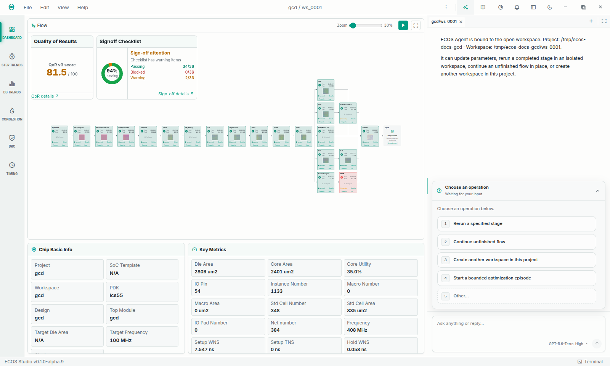

### Guided Setup and Quick Start

On Home, **Run your own RTL-to-GDS flow** guides you through project selection,
workspace naming, RTL, PDK, and design settings. Review the proposed setup,
then confirm creation and execution. Cancelling the proposal creates no
workspace and starts no flow.

The Home Agent's **Get started** conversation also offers **Quick Start** for
the built-in GCD example. It requires ready GCD, ICS55 PDK, and MPC resources;
missing resources are reported before creation. The walkthrough opens Project
Management, creates a project and workspace, and starts the full flow. Its
final success or failure message follows the actual flow result. **Stop Quick
Start** stops setup or requests cancellation of the flow after it has started;
you can also use **Background Tasks → Cancel Flow**.

### Proposals and Confirmation

When the agent wants to act on the workspace (set up or create a workspace,
rerun a step, continue an unfinished flow, update parameters), a contract panel
shows the full key/value details and asks you to **Confirm** or **Cancel**.
Confirmed actions execute immediately; committed panels collapse into receipts
that you can expand (**Details / Hide details**).

- **Parameter changes** save the agreed values without automatically running
  the flow.
- **Rerun a completed stage** creates and opens an isolated target workspace,
  preserving the source workspace and its earlier results. Choose either the
  selected stage alone or continuation from that stage through Harden.
- **Continue unfinished flow** resumes in the current workspace.

### Optimizing a Completed Design

On Home, choose **Optimize a completed design**, select a baseline workspace
completed through Harden, and describe the goal. You can also request
optimization from a workspace chat. Review the proposed primary metric,
metrics to preserve, and signoff gates before confirming the optimization.

Candidates execute in isolated workspaces. A baseline without noise
calibration first runs three replays. Optimization has automatic execution,
planning, and time budgets; this is not a single flow run. The optimization
card shows progress and offers **Pause**, **Resume**, **Retry**, or **Stop**
when applicable.

Closing an active optimization's chat tab offers **Stop and Close** or **Keep
Running**. **Keep Running** leaves it active in the background; click its
**Background Tasks** entry to reopen the owning conversation and its controls.

### Agent Sessions

The tab strip above the chat supports multiple concurrent conversations:
switch tabs, close a tab (`×`), or start a **+ New Agent chat**. The panel menu
offers **Full screen** for the workspace chat.

### Agent Setup

If Codex or the selected model source is not ready, the panel shows a setup
card with its status, version, and executable path. Select a model source,
enter its API key, and use **Save and use**. **Manage** opens the model-source
settings. The card also offers installation, re-detection, and local Codex
selection when applicable. Once ready, continue the conversation.

---

## Frontend Design (Experimental)

The frontend environment has two design profiles: **General RTL** for source
review, elaboration, and lint, and **CPU Core** for verification with a SoC
harness, simulation, waveforms, and difftest. It remains experimental; the
frontend screens display a warning that behavior may change between releases.

### Frontend Landing Page

Reaches via the **Frontend Design** card. Mirrors the backend landing page:

- **Back to ECOS**, **Open Workspace**, **New Workspace** (opens the frontend
  wizard), and a **Recent Workspaces** list filtered to frontend projects —
  same badges, _View All / Collapse_, remove-from-list, and
  unrecognized-state behavior as the backend page.

### Frontend Workspace Wizard

Three steps (the left step strip allows going back):

1. **Project Setup** — select an existing frontend project or create one
   under a chosen parent directory. Set the project, workspace, and design
   names, and an optional description. The preview shows the project manifest
   and workspace location. Select **General RTL** or **CPU Core** under
   **Design Type**. An existing project may lock this choice.
2. **RTL Setup** for General RTL, or **Verification Setup** for CPU Core.

   **General RTL:** choose Verilog/SystemVerilog sources or a filelist, set the
   top module, and optionally provide a clock port and target frequency. It
   needs no CPU adapter, SoC harness, toolchain, or test suite. This profile runs
   **Prepare → RTL Review → Elaboration → Lint**; simulation is not included.

   **CPU Core:**

   - **CPU** — pick a CPU core (card selector); choosing a custom filelist
     reveals a **CPU Top Module** field.
   - **CPU Design Files** — either **Use filelist** (single file) or **Select
     RTL files** (multi-select with add/remove/clear and a **Confirm
     selection** step). Accepts `.v` / `.sv` / headers.
   - **SoC Harness** (card selector, required), **Toolchain** and **Test
     Suite** row selectors, each with a status pill.
   - **CPU Top IO Contract** — the required top module name, IO counts, reset
     PC, program link base, boot payload base, and a full interface example.
   - A **Validation** panel lists errors and warnings live.

3. **Review & Create** — two review blocks (with **Edit** jump-back links) and
   **Create Workspace**.

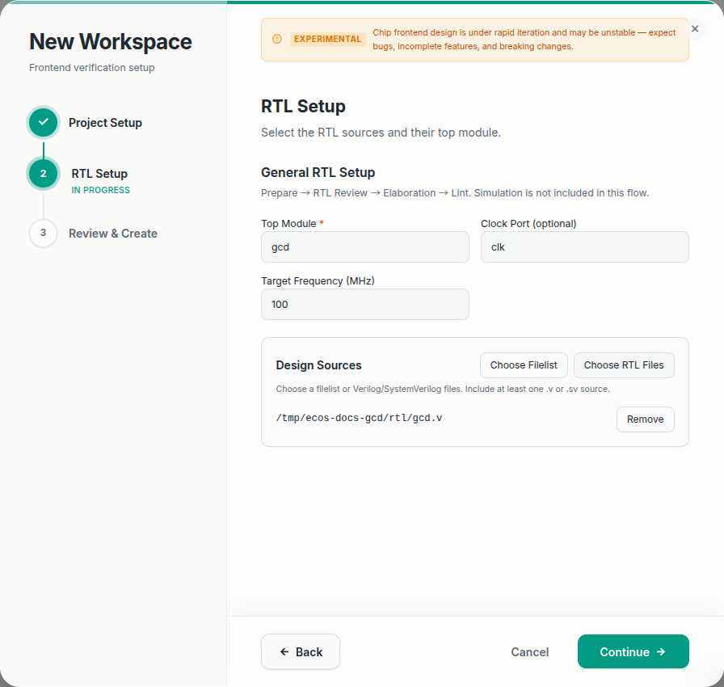

### Frontend Workspace Layout

- **Left icon rail** — Home, Prepare, Src, Review, Elab, Lint, Sim, Wave (Src
  and Wave are fullscreen views; the others are flow steps). Status badges as in
  the flow overview. General RTL omits the CPU simulation and waveform steps.
- **Flow panel** (240 px) — Done / Run / Fail / Wait counters, a total progress
  bar, the step list with per-step peak memory and runtime, and (on Home) the
  run-mode dropdown (**Run Frontend Flow** / **ReRun Frontend Flow**) plus the
  **▶ Run** button.
- **Step header** — status, runtime, tool, case counts (sim), **Log** button,
  **Run / Cancel** (not on sim; running shows a timer), and **Refresh**.
- **Bottom console** — a draggable height panel with **Problems** (issues in
  the current log; click to open) and **Log** (log-file selector + viewer)
  tabs.
- **Home view** — summary tiles (workspace name, step count, completed x/y,
  next step), the read-only **Frontend Configuration** card, a **Workspace
  Home** status card, and a **Workspace Guide**.

### Step QoR

Use the step header's **QoR** action or the **QoR** tab to inspect its quality
assessment. It includes an available score breakdown, the input snapshot,
quality gates, measured results, and any reported hotspots. **Pass**,
**Blocked**, **Incomplete**, and **Unavailable** describe the available
evidence; missing, stale, or running results do not imply a passing check.

### Prepare

Overview tiles, a configuration card with prepare-readiness, an inputs card
(CPU RTL vs. total RTL, includes, defines, ownership bars, per-source file
lists), contracts status, and the runtime plan.

### RTL Review

A left rail switches review modes:

- **Source Scan** — RTL rule violations (severity-colored, waived markers);
  click an issue to jump to source.
- **Yosys Precheck** — diagnostics on the left, fanout/fanin/depth hotspot
  cards on the right (click to open).
- **Modules** — Yosys module risk-ranking cards (risk level plus
  cells/mux/arith/mem/fanout/fanin/depth/score).

The **Review** tab contains the review views; use the **QoR** tab for the
step's quality gates and measured results.

### Elaboration (Elab)

- **Authoritative** — Slang elaboration diagnostics (click to jump to source),
  unresolved modules, and heuristic candidates.
- **Module Inventory** — module cards (path:line, instance count, ports,
  params, refs, TOP marker); click to open a module.
- Use the **QoR** tab for the elaboration quality assessment and metrics.

### Lint

- Scope switch: **CPU n** or **Design n**, depending on the profile
  (actionable design diagnostics), and **All n** (every Verilator diagnostic).
- Diagnostics list (click to jump to source), **Rule Breakdown** (rules with
  E/W counts and examples), and **File Hotspots** (files with the most
  diagnostics).

### Simulation (Sim)

Simulation, cases, and waveforms in this section apply to the CPU Core profile.

- **Suite** dropdown; choosing `cpu_tests` reveals a **Mode** dropdown
  (Selected / All) and a **Cases** multi-select (run Prepare first to load CPU
  tests).
- **Run {Suite} / Cancel** button with a run timer.
- **CoreMark panel** (for the CoreMark suite) — preset (Balanced / Speed /
  Size / Debug / Custom), optimization level, ISA, ABI, iterations, data size,
  extra CFLAGS, and a float-reporting checkbox, plus a build summary.
- A run-context card shows the current selection, displayed result, and result
  freshness.

### Cases and Waveforms

The **Cases** tab lists regression results:

- **Run Regression** — baseline run, comparison tiles, and per-case cycle
  changes (faster/slower colored).
- **Run History** — the last five runs with pass/fail counts.
- **Cases table** — case name, PASS/FAIL badge, cycles, outcome, **Difftest**
  status (click to jump the disassembly to the mismatch PC), **Code** (expand
  an inline disassembly pane: address jump, reload, close), RC, **Image**, and
  a **Wave** button per case.

### Source Editor

The **Src** view is a fullscreen source workspace:

- Left — file list with per-file diagnostic badges (red errors, amber
  warnings).
- Right — a Monaco editor toolbar with status (Saved / Unsaved / Saving /
  Loading), **Reload**, **Save** (only with unsaved changes; files over 4 MB
  are truncated and cannot be saved), and **Lint** (runs Verilator on the
  current file; results list with click-to-jump, plus the raw lint log).
- Right-click inside the editor for the standard editing menu.

### Waveform Viewer

The **Wave** view lists waveform files per case on the left and embeds the
**Surfer** waveform viewer on the right (loading and error overlays included).
**Open** launches the waveform in an external Surfer application.

---

## Global UI

### Notifications

The bell icon in the top bar carries an unread badge (99+ past 99). The panel
lists notifications colored by severity (error / warning / info) with
timestamps; each can be expanded (**View details**, including log file paths),
marked read, or dismissed. **Mark all as read** and **Clear all** act on the
whole list. `Esc` closes the panel.

### Background Tasks

The progress icon shows a badge with the running task count (or `!` on
failure). The panel lists:

- Running flows — workspace name, current step, status (Queued / Running /
  Cancelling), elapsed time; click a row to **Inspect**, and **Cancel Flow**
  where permitted.
- Agent optimization episodes — progress and state; click one to reopen its
  conversation and use the episode controls.
- In-progress workspace creations, including a _Creation needs recovery_ hint.
- Final snapshot saves, with a **Retry** button on failure.

### Closing Studio

Closing Studio leaves detached backend ECC flows running. Reopen their
workspace to observe the current state, or use `ecc status` in a terminal.
Use **Cancel Flow** to stop a backend run explicitly.

Workspace creation, Agent optimization, and pending saves have their own close
handling. When **Work is still in progress** appears, choose **Wait and Close
Safely** or **Cancel**. The close-status indicator lets you view background
tasks, **Keep App Open**, or review **Force Quit…**. Force quitting can leave
unfinished creation or local state requiring recovery. Frontend runs and Agent
optimization do not inherit the detached backend flow lifecycle.

### Terminal Panel

Toggle **Terminal** from the status bar at the bottom-right. Features:

- Drag the top edge to resize; **New Terminal** (`+`) for more sessions;
  **Terminal Profiles** (default shell); **More Actions** (maximize/restore,
  close panel).
- A right-hand session list switches between terminals and can be resized by
  dragging its separator.
- Follows the application theme.

Use `ecc` to create projects and run backend flows with Studio's runtime. See
[Using ECC in the Terminal](#using-ecc-in-the-terminal) for setup, execution,
and workspace-selection examples.

### Theme, Zoom, and About

- **Theme toggle** (sun/moon) in the top bar switches light/dark; the choice
  persists and editor colors follow.
- **View menu** zoom (80–140%, persisted).
- **Help → About** shows component versions with **Copy version info**.

### Exporting Results

**Signoff delivery:** **File → Export Signoff Package** opens the review
dialog. Check its resource summary and risks. **Ready to Export** or **Export
With Attention** permits export; **Export Blocked** requires resolving the
listed blockers. This action is disabled while a flow runs.

**Design summary:** **File → Export Design Summary** previews LaTeX, Markdown,
Typst, CSV, or text. Copy the current format, save it, or use **Export All
Formats (5 Files)**. Options include multi-corner timing and stage execution
breakdown, plus standalone-document options for LaTeX and Typst.

**CLI evidence archive:** use ECC's reproducible export to archive available
project/workspace evidence with a checksummed manifest and runtime information:

```bash
ecc reproducible export --project /path/to/project --workspace ws_0001 \
  --output /path/to/evidence.tar.gz
ecc reproducible verify --package /path/to/evidence.tar.gz
ecc reproducible inspect --package /path/to/evidence.tar.gz --files
ecc reproducible report --package /path/to/evidence.tar.gz
```

This evidence archive serves diagnosis and handoff. It is separate from the
signoff delivery package and does not bundle a portable toolchain or guarantee
that every external input can be replayed on another machine.

---

## Troubleshooting

**A flow step failed**

1. Click **Log** on the failed step's Flow diagram card.
2. Open **Details** for its checklist and inspect the relevant evidence.
3. Verify the project's design inputs, PDK, and workspace parameters.
4. Fix configuration via **Edit → Config**, then re-run the step.

**Harden succeeded, but EMIR is red or Signoff shows warnings**

- EMIR is advisory and can fail without stopping Harden. If its log says
  `technology_file_path is a placeholder`, configure a real technology file
  and rerun it as described under [Advisory Checks](#advisory-checks).
- Antenna Check also stays advisory after execution. Inspect its log and
  report for missing antenna rules or incomplete coverage.

**A CLI run does not appear in the workspace**

- Check `ecc status --project DIR --workspace NAME` and confirm both selectors
  refer to the workspace open in Studio.
- Use a new built-in terminal session after installing or changing runtime
  resources. A host shell may resolve a different ECC installation.
- **Status unavailable** means Studio could not read verified flow state;
  inspect the reported path or error before treating it as a completed run.

**Snapshot Rebuild Required**

Use **Rebuild Snapshot** in the recovery dialog to replace the unreadable or
unsupported `home/engineering-snapshot.json`. Studio regenerates it from the
workspace's flow state when reopening; this does not rerun the flow or replace
the whole workspace directory. **Cancel** leaves the file untouched.

**Workspace Identity Mismatch**

The saved snapshot belongs to a different workspace identity, often after a
manual directory copy. Studio refuses to open it automatically. Create a new
workspace or use **Create from output** in Project Management for a supported
branch instead of deleting identity data to force it open.

**The Run button is disabled**

- A flow is already running, or
- the Chip Viewer is saving layout edits (tooltip explains), or
- the app is finalizing a background operation.

**"Stale" badges and warning bars**

- Results were produced by an older configuration or files changed on disk.
  Re-run the affected step; treat stale artifacts as non-sign-off evidence.

**Layout thumbnail cannot be opened**

- The tooltip on the step card's thumbnail names the reason: too large, invalid,
  changed externally, stale, or missing.

**Performance**

- Close unused Chip Viewer windows and unused layouts.
- Reduce visible layers in the Chip Viewer sidebar.
- Check RAM/CPU; 8 cores and 32 GB RAM are recommended.

**Getting help**

- **Help → Documentation** opens this guide.
- Report bugs or request features: [GitHub Issues](https://github.com/openecos-projects/ecos-studio/issues).
- Ask questions: [GitHub Discussions](https://github.com/openecos-projects/ecos-studio/discussions).
- **Help → About → Copy version info** pastes versions into your report.

---

## Next Steps

- **Try a small design** — import your GCD RTL, create a workspace, and run
  the full RTL-to-GDS flow. See the terminal example above for the required
  project, PDK, and workspace settings.
- **Explore the frontend environment** — run Prepare → Review → Elab → Lint →
  Sim on a CPU design and inspect waves.
- **Automate** — install the `ecos-ecc` CLI from Resource Manager and script
  flows on the command line.
- **Join the community** — participate in [GitHub Discussions](https://github.com/openecos-projects/ecos-studio/discussions).
